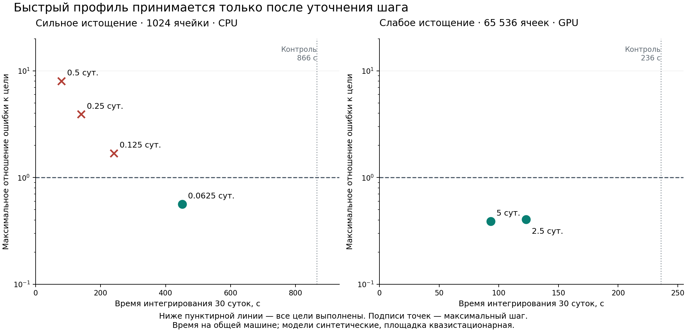

# Скорость полного прогноза при явно заданной численной точности

Серия отделяет регрессию почти идентичного исполнения от проверки
численной точности прогноза. Бюджеты заданы до запусков в `budgets.json`:
конечное давление/BHP 1000 Па, Sw/Sg 2e-4, Rs 0,05, компонентные дебиты
и накопленные отборы 0,2%. BHP, дебиты и накопления проверяются на всех
общих отчётных датах, пространственные поля — в конце горизонта.
Это цели данных синтетических случаев, не универсальные промышленные
допуски и не граница ошибки относительно экспериментальной истины.

## Область моделей

Обе модели: black-oil FIM, один PVT-регион, изотермический пласт,
добывающие скважины, сборное дерево, сепарация, водяная сеть и газовая
компрессия/экспорт с ограничением мощности. Площадка квазистационарная,
сборная сеть на CPU. Полная динамическая тепловая PR-сеть, нагнетательная
инфраструктура, Norne и произвольный граф этой серией не квалифицируются.

- `large`: 65 536 однородных декартовых ячеек, 64 скважины; ячейка
  20 × 20 × 80 м. Слабое истощение: максимальное снижение пластового
  давления за 30 суток около 172 Па. GPU-пласт/СЛАУ на RTX 3090 Ti,
  Torch allocator 12%, один CPU-поток.
- `depletion`: 1024 ячейки, 16 скважин; ячейка 2 × 2 × 0,8 м.
  Сильное истощение: давление снижается с 3 до примерно 2,26–2,32 МПа,
  Sg растёт с 0,03 до примерно 0,114–0,117. Один CPU-поток; время этой
  серии не является измерением GPU.

Горизонт каждого запуска — **30 суток**. На 10-х сутках максимальное
открытие газового экспортного клапана меняется до 0,8, на 20-х возвращается
исходное управление. События не пересекаются временным шагом. Отчётные
даты: каждые 5 суток для большой модели, ежедневно для сильного истощения.

## Численный метод и условия приёмки

Проверен существующий BE-путь без локального `temporal_control`:
на каждом временном шаге не выполняются дополнительный полный шаг и
две половины для оценки дефекта. Обычные Ньютон, ограничение изменения
насыщенности, отказ/дробление и максимальный шаг продолжают работать.
Точность этого режима проверяется отдельным расчётом с меньшим максимумом.
Такой профиль не является автоматически контролирующим ошибку для
произвольного нового сценария. При изменении модели/управления требуется
обновлённая проверка либо возврат к локальному оценщику.

CNV/MB, уставки и материальный аудит сохранены: CNV 1e-9, MB 1e-12
для малой модели и 5e-15 для большой. Строгая проверка баланса компонентов
остаётся `0.01 кг + 1e-8 * фактический отбор`. Ни одна настройка не менялась
в ходе интегрирования. Все пары используют одинаковые физику, Python/PVT,
backend, устройство и лимиты памяти; различается только максимальный шаг.
Начальный шаг в большой модели — 1 сутки, в малой — 0,00005 суток.

Большая модель: максимумы 5 / 2,5 / 1,25 суток. Сильное истощение:
0,5 / 0,25 / 0,125 / 0,0625 / 0,03125 суток. Сохраняются и не прошедшие
проверку варианты. Рабочий кандидат выбирается по сравнению непосредственно
с самым мелким завершённым уровнем, не только с ближайшим соседом.
Сравнение дискретизаций не доказывает абсолютную ошибку точного решения.

`check_facility_engineering_profile.py` переиспользует строгие проверки
completion, checksum, одинаковых Python/PVT, физической конфигурации,
горизонта и реального увеличения временной разрешённости. Материальный
аудит не ослабляется. Новый инструмент принимает явно заданные бюджеты
полей и скважин; не подбирает допуски решателя автоматически.

## Артефакты и воспроизведение

`qualification.json` содержит все времена, память, числа стадий,
фактические FIM/линейные попытки принятых стадий, проверки против самого
мелкого уровня и выбранные профили. При наличии отказов счётчики принятых
стадий не следует выдавать за всю работу. `*_refinement_*.json` содержит
соседние уточнения. В `*_run*` находятся полные траектории, source guard,
протоколы и журналы. `executed_sources.tar.gz` — общий снимок исходников.
Новый проверяющий скрипт создан после заморозки физического кода и
приложен отдельно. 33 проверки проверяющего инструмента и прежних
защит от некорректного уточнения пройдены; лог — `checker_tests.log`.

Времена относятся к интегрированию, **не включают** импорт Python,
построение модели и финальную запись/проверку артефактов. Машина и GPU
общие; CPU/GPU-серии и часть CPU-уточнений выполнялись параллельно.
Это наблюдения времени, не изолированный аппаратный benchmark.
Нельзя переносить время слабого истощения на сильное, другой размер
сетки, Norne, миллион ячеек или многолетний полный динамический граф.

Запуск большого проверенного примера на той же машине:

```bash
CUDA_VISIBLE_DEVICES=GPU-2f9ce359-f3f4-accc-bf9c-31bc88bb1cb7 \
CUBLAS_WORKSPACE_CONFIG=:4096:8 OMP_NUM_THREADS=1 MKL_NUM_THREADS=1 \
PYTHONPATH=src:scripts python scripts/run_fim_facility_forecast.py \
  --config configs/fim_blackoil_facility_field64k_forecast.json \
  --schedule benchmarks/reports/surface_forecast_profiles/schedule.json \
  --days 30 --report-days 5 --device cuda --cuda-memory-fraction .12 \
  --output /tmp/field64k-forecast
```

Для новой проверки уточнения скопируйте публичный конфиг в отдельный
файл и уменьшите `simulation.max_time_step_days` до 1,25, сохранив
остальные параметры, код и команды запуска. Оба каталога результата
проверяются одной командой:

```bash
PYTHONPATH=src:scripts python scripts/check_facility_engineering_profile.py \
  /tmp/field64k-forecast /tmp/field64k-reference \
  --budgets benchmarks/reports/surface_forecast_profiles/budgets.json \
  --days 30 --output /tmp/field64k-accuracy.json
```

UUID выбирается явно. В архивных конфигурациях сохранены исходные
абсолютные пути PVT; для другого checkout используйте копии конфигов
с актуальным PVT. Не редактируйте архивы после расчёта.

## Завершённые замеры и выбранные профили

Восемь полных 30-суточных расчётов завершились без отклонённых шагов.
Сравнение каждого кандидата выполнено непосредственно с самым мелким
шагом своей серии, а не только с соседним уровнем.

- **65 536 ячеек, 64 скважины, RTX 3090 Ti:** выбран максимум 5 суток,
  93,319 с интегрирования, 9 шагов, 57 FIM-проб и 185 линейных попыток.
  Относительно контроля с максимумом 1,25 суток: давление 3,568 Па,
  BHP 5,994 Па, дебиты 0,0778%, накопленные отборы 0,0216%.
  Контроль занял 235,825 с. Это слабое истощение: максимальное падение
  давления лишь около 172 Па. Пик выделенной памяти Torch 409 МБ,
  без контекста CUDA и памяти других процессов.
- **Сильное истощение, 1024 ячейки, 16 скважин, CPU:** выбран максимум
  90 минут, 451,632 с интегрирования, 490 шагов, 3106 FIM-проб.
  Относительно 45-минутного контроля: давление 74,501 Па,
  BHP 166,247 Па, дебиты 0,0982%, накопленные отборы 0,1130%.
  Контроль занял 865,618 с. Более крупные шаги не прошли заданные цели.
  Даже соседняя пара 3 часа / 90 минут дала 0,2259% по накопленным
  отборам при цели 0,2%; этот быстрый кандидат не опубликован как принятый.

Это выбор численно проверенного шага для двух конкретных сценариев,
а не универсальное ускорение ядра или оценка ошибки относительно
точного решения. Все времена получены на общей машине, без изоляции
нагрузки; построение модели и итоговый аудит не входят во время интегрирования.


