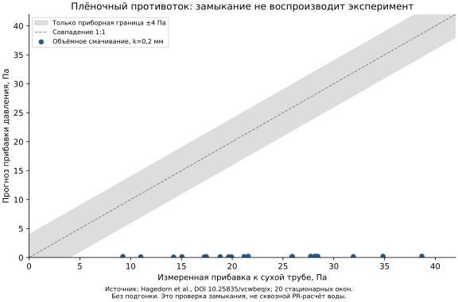

# Экспериментальная проверка многофазных замыканий

Отдельный `validate_annular_film_experiment.py` теперь возвращает код 1 при
отрицательной физической квалификации. Для диагностической выгрузки доступен
явный `--report-only`; он не меняет отрицательный статус в JSON.
[Актуальный полный экспериментальный прогон](../benchmarks/reports/surface_experiments_current/README.md)
завершён с отрицательным итогом; это не отказ численного выполнения.

Повтор интерфейсного замыкания на 16 измеренных режимах дополнен независимым
скалярным решением: радиальная квадратура и два поиска корня Brent. Максимальная
разность с Torch — 3.07e-12 Па на измерительном пролёте, тогда как MAE против
эксперимента остаётся 58.84/48.28 Па. Численная реализация этих стационарных
уравнений не объясняет экспериментальный разрыв. Конкретный недостающий механизм
этим сравнением не установлен; экспериментальная квалификация остаётся отрицательной.
[Диагностика и воспроизведение](../benchmarks/reports/annular_independent_verified/README.md).

## Текущий вывод

**`darcy_volume_wetted_v1` не подтверждён для вертикального плёночного
противотока газ–жидкость.** На сопоставленных стационарных участках
измеренная прибавка перепада давления к сухой трубе составляет 9.23–38.68 Па,
а стационарный предел текущего замыкания даёт 0.039–0.236 Па в двух заранее
заданных вариантах шероховатости. Все 20 сопоставлений выходят за приборную
разностную границу ±4 Па. Это отрицательный результат проверки, а не
успешная калибровка.



Вывод относится к данному замыканию в данном режиме. Он не означает, что
другие газожидкостные или нефтеводяные режимы проверены или опровергнуты.
Совпадение однофазного Кольбрука и сохранение энергии в численных тестах
не подтверждают распределение смоченного периметра между фазами.

## Первичные данные и права использования

Использованы оригинальные, не изменённые по содержимому книги:

- `tests/data/surface/hannover_countercurrent/dry_pipe.xlsx`;
- `tests/data/surface/hannover_countercurrent/countercurrent.xlsx`.

Авторы: Janina Hagedorn, Markus Wirth, Bernhard Weigand, Stephan Kabelac.
Набор [Hydrodynamic investigations for a two-phase geothermal pipe](https://doi.org/10.25835/vcwbeqix)
распространяется по CC BY 4.0. Исходные имена членов архива, URL загрузки
и SHA-256 сохранены в `manifest.json`, лицензия — в `LICENSE.txt`.
Данные только переименованы для стабильных локальных путей.

Геометрия и условия сопоставлены с
[публикацией авторов](https://doi.org/10.1016/j.applthermaleng.2026.130975):
гладкая вертикальная труба диаметром 85 мм, расстояние между отборами
давления 3 м. Используются только гладкие трубы; гофрированные данные
не смешиваются с ними. Указанная авторами приборная граница DP — ±2 Па.

## Что именно сравнивается

Это **стационарная проверка замыкания сопротивления**, не сквозная
PR-симуляция воды и воздуха и не проверка переходного процесса.
Свойства воды заданы явно как референс при 20 °C: rho=998.2 kg/m³,
mu=0.001002 Pa·s. Плотность воздуха вычисляется из измеренных P/T в
идеально-газовом приближении; mu_air=1.81e-5 Pa·s. Эти свойства не названы
измеренными в книгах и не используются для заявления о точности PR воды.

При заданных расходах решается стационарный предел реально реализованного
`darcy_volume_wetted_v1`: общий градиент давления фаз, их собственные
скорости, смоченный периметр пропорционально объёмной доле. Межфазное
трение и химический BGK-источник в этом отдельном испытании отсутствуют.
Для восходящей координаты и нисходящей жидкости:

```
u_l = -m_l / (rho_l*A*alpha_l)
u_g = Q_g / (A*(1-alpha_l))
dp/dz |_l = -rho_l*g + f_l*rho_l*u_l^2/(2*D)
dp/dz |_g = -rho_g*g - f_g*rho_g*u_g^2/(2*D)
```

Выбирается тонкоплёночная газосодержащая ветвь `0 < alpha_l < 0.1`.
Используется тот же Torch `darcy_factor`, что в runtime. Отдельный
скалярный Кольбрук проверяет уравнение ветви в тесте. Шероховатости
0 и 0.2 мм заданы до сравнения; параметры по мокрому перепаду не обучаются.

Измеренные потери включают элементы стенда. Поэтому сравнивается **прибавка
мокрой трубы к измеренной сухой** при том же газовом объёмном расходе,
а не голое сопротивление трёхметровой трубы со всем стендом сразу.
Гидростатический член воздуха в пределе одинаковой плотности вычитается
вместе с сухой базой. Эффекты различий P/T, местных потерь, смачивания,
волн и нестационарности остаются ограничениями этого отдельного испытания.
Они не объявлены точно воспроизведёнными.

## Отбор данных до расчёта ошибки

Используются неперекрывающиеся блоки по 60 исходных записей. Это число
записей, **не** заявление о точно известной частоте дискретизации.
Условия принятия зависят только от входных измерений:

- конечные значения всех необходимых каналов;
- средний газовый расход 100–200 м³/ч, CV не выше 5%;
- для мокрого случая расход жидкости 0.03–0.13 kg/s, CV не выше 10%.

Ни давление, ни ошибка модели не используются для отбора стационарных окон.
Это отдельно проверяется тестом с изменением только измеренного давления.
Сухие окна объединяются в фиксированные интервалы по 5 м³/ч; между
средними расходами выполняется линейная интерполяция. Экстраполяции нет.

Получено 6 сухих и 31 мокрое окно; 20 мокрых покрываются сухой базой,
11 исключены из-за отсутствия покрытия. Все причины исключения и исходные
номера строк сохранены в машинном результате. Сглаживание или удаление
неудобных точек по итоговой ошибке не применяются.

Приборная разностная граница ±4 Па — сумма двух границ ±2 Па. Это **не**
95%-й доверительный интервал. Соседние временные измерения не считаются
независимыми для выдуманного уменьшения ошибки как 1/sqrt(N).

Средняя абсолютная ошибка прибавки: 22.26 Па для гладкого варианта и
22.17 Па при k=0.2 мм. Изменение шероховатости в этом диапазоне не устраняет
разрыв. Эти числа — диагностика данного испытания, не универсальная
метрика качества всех моделей течения.

## Что пока не засчитывается

- RELAP-7 bubbly/slug не переносится на опубликованный плёночный annular
  противоток за пределами своей области применимости.
- Горизонтальное stratified-замыкание не применяется к вертикальной трубе.
- KTH/HWAT DOI 10.5281/zenodo.14627088 найден и изучен, но не оценён:
  определения скорости и единицы отдельных полей требуют сверки с полной
  публикацией. Неоднозначные поля не пересчитываются молча.
- Пузырьковое удержание, нефть–вода, унос капель и тепловые свойства этим
  pressure-тестом не подтверждены.

## Воспроизведение

```bash
CUDA_VISIBLE_DEVICES='' OMP_NUM_THREADS=1 MKL_NUM_THREADS=1 PYTHONPATH=src:scripts \
  python scripts/validate_multiphase_experiments.py \
  --output /tmp/multiphase_experiments.json
```

Результат сохранён также в `benchmarks/results/multiphase_experiments.json`.
Этот исходный результат потребовал отдельной плёночной геометрии и
двустороннего переноса импульса, реализованных далее. Их собственная
экспериментальная проверка остаётся обязательной. Подгонка общего трения
для скрытия отсутствующего механизма не считается исправлением.

## Отдельная проверка кольцевой плёнки

Добавлен `src/surface/annular_film.py`: стационарная вертикальная
газожидкостная модель с полностью смоченным кольцевым слоем. Уравнение
Стокса интегрируется по реальной геометрии слоя с прилипанием к стенке
и касательным напряжением на границе газа. Удержание и общий градиент
давления решаются совместно; межфазные силы равны и противоположны.
Нет искусственного остаточного запаса, подгонки коэффициентов или
экстраполяции за найденную тонкоплёночную ветвь.

Межфазный Fanning-фактор .005*(1+300*delta/D) взят из Wallis, приведённого
в [первичной публикации](https://doi.org/10.1016/j.applthermaleng.2026.130975).
В этой реализации скорость — относительная скорость ядра и среднего
течения плёнки. Это явно отдельный вариант: в формулах цитируемой статьи
используется поверхностная скорость газа. Нельзя приписывать нашему
варианту экспериментальную подтверждённость исходной корреляции.

Уравнение профиля независимо проверено решением радиальной краевой задачи
SciPy в тестах; рабочий расчёт использует Torch и поддерживает CUDA.
Проверены балансы сил газа/жидкости, отказ вне области применимости,
CPU/CUDA и отсутствие корня при чрезмерном встречном газовом потоке.
Режим ограничен Gamma/mu <=400 и alpha_l <=0.3. Это не карта режимов,
не модель уноса капель и не переходная PR-труба.

Экспериментальная проверка **не пройдена**: из прежних 20 сопоставленных
окон 16 входят в объявленную область по расходу жидкости; четыре исключены
по этому входному критерию, без анализа ошибки давления. На этих же
16 окнах MAE исходной модели 21.74/21.67 Па, новой — 53.88/43.32 Па
для гладкой стенки/шероховатости 0.2 мм в сухом baseline. Все ошибки
выходят за инструментальный предел +/-4 Па. Увеличение межфазного трения
само по себе не исправило прогноз. Нужны независимые замыкания для
волновой/частично смоченной плёнки и уноса с подтверждением области
применимости; подбирать коэффициенты по этим же окнам нельзя.

Результат сохранён в `benchmarks/results/annular_film_experiments.json`,
повтор: `PYTHONPATH=src:scripts python scripts/validate_annular_film_experiment.py
--output /tmp/annular-film.json`. Исходный отрицательный результат не удалён.
Новый стационарный решатель **не включён** в динамическую PR-трубу:
замена её источника требует согласованного переноса энергии и новой
проверки переходных режимов. Экспериментальную квалификацию трёх блоков
по этим результатам закрытой считать нельзя.

## Динамический источник с работой на межфазной границе

Следующая реализация `laminar_annular_wallis_interface_v1` перенесена в
`pr_active_annular_friction.py` и подключается опционально к активной трубе.
От прежнего стационарного варианта она отличается использованием скорости
реальной поверхности плёнки, двусторонним импульсом, передачей работы
между полными энергиями фаз, ламинарным газовым пределом и решением
backward Euler. Подвижность тонкой плёнки вычисляется без потери значащих
цифр и без добавления фиктивной массы. Полные уравнения, ограничения и
параметры переходной области описаны в [PR_ACTIVE_SURFACE.md](PR_ACTIVE_SURFACE.md).

Независимые численные проверки:

- радиальная Stokes-краевая задача, без повторного вызова runtime-профиля;
- другое скалярное интегрирование профиля и NumPy 2x2 solve в аудиторе;
- DOP853-решение нелинейного локального ODE, с подтверждённым первым
  порядком по импульсу и межфазной энергии при уменьшении dt;
- laminar Poiseuille-предел газа при alpha_l→0, без остаточной фазы;
- конечный патрубок с командами открыто/закрыто/половина площади,
  гравитационные N/E-балансы, restart и CPU/CUDA-паритет.

Эти проверки подтверждают реализацию уравнений, а не экспериментальную
правильность корреляции Wallis в любом режиме. Повтор по тем же входным
окнам Hannover дал MAE 58.84/48.28 Па; ни одно из 16 окон не уложилось
в инструментальный разностный предел. Данные и коэффициенты не менялись.
Результат: `benchmarks/results/annular_interface_experiments.json`.
Для этого варианта CLI использует `--shear-velocity interface`.

Отрицательный вывод согласуется с ограничением самого источника данных:
в [заключении первичной статьи](https://www.sciencedirect.com/science/article/pii/S1359431126012834)
авторы сообщают, что рассмотренные корреляции не применимы к размерам и
скоростям их установки. Это не основание исключать неудобные точки и
объявлять наш вариант прошедшим. Для квалификации именно такого режима
нужны проверенные замыкания волн, смачивания и уноса либо независимые
данные по режиму, где выбранная модель применима. Четыре ранее исключённых
окна по-прежнему вне объявленной ламинарной области; они не возвращаются
в неё изменением порога после просмотра давления.

Общая функциональная матрица теперь содержит 11 CPU/CUDA-сценариев,
включая новый плёночный патрубок. Результаты с хешами источников:
`benchmarks/results/pr_active_annular_matrix.json`, сверка устройств —
`pr_active_annular_matrix_parity.json`. Их успешный статус не заменяет
отрицательный экспериментальный статус, хранящийся отдельно.


## Общий внешний барьер и актуальный повтор

`scripts/validate_surface_experiments.py` повторно использует существующие
проверяющие исходных Hannover-измерений и добавляет измеренные VLE-состояния
метан–этан May et al. Подробности термодинамического протокола приведены
в [REFERENCE_VALIDATION.md](REFERENCE_VALIDATION.md). Сравнения чистых
давлений по NIST Antoine сохраняются отдельно как эмпирические корреляции.
Численные тесты сохранения и результаты CoolProp в экспериментальные
прохождения не включаются.

```bash
PYTHONPATH=src:scripts python scripts/validate_surface_experiments.py \
  --output-dir /tmp/surface-external-validation
```

Каталог должен быть пустым. Сохраняются все отчёты, затем `summary.json`.
По умолчанию невыполнение заявленного Hannover-критерия возвращает код 1.
Это отрицательный результат квалификации режима, а не потерянный вывод
или авария численного решения. `--report-only` позволяет завершить
архивирование с кодом 0, сохраняя `gate_passed=false`; статус физической
валидации он не изменяет.

На текущем коде повторены все прежние варианты. Для используемого
межфазного варианта `laminar_annular_wallis_interface_v1` остаются MAE
58,84/48,28 Pa и нулевая доля попадания в инструментальный разностный
предел для всех 16 сопоставленных окон. Два заранее заданных варианта
сухой шероховатости не подбирались. Сухие/мокрые исходные книги, правила
отбора и область ламинарной модели не менялись. Физическая квалификация
этого режима не пройдена; положительное сравнение отдельных PR-свойств
этот результат не заменяет.

Барьер относится к конкретному стационарному противотоку и принятому
инструментальному сравнению. Его граница +/-4 Pa не является полным
бюджетом экспериментальной неопределённости или 95%-м интервалом.
Остаётся разбор источников расхождения, включая геометрию/смачивание,
волновую плёнку, унос и ограничения корреляции; вклад каждого механизма
нужно подтверждать данными, а не назначать по одному итоговому MAE.

Полная связанная переходная сеть, уровни/унос сепараторов, паспортные
карты оборудования и реальные нефтеводяные свойства требуют отдельных
экспериментальных наборов. Итог хранится в
`benchmarks/results/surface_external_validation.json`, полные отчёты —
в проверенном gzip-архиве рядом. Старые отрицательные отчёты сохранены.

## Область применимости и раздельные сухие серии

Проверка полной первичной статьи уточнила существенное ограничение:
в разделе 3 авторы прямо указывают невозможность гарантировать полное
смачивание стенки пилотной трубы и наблюдение отделившихся капель.
Раздел 2.1.2 описывает измерение перепада на участке с распределителем
жидкости. Это не измерение одного только установившегося кольцевого
течения. Доля смоченной стенки и отдельные мокрые потери распределителя
в используемых книгах не заданы.

Следовательно, отрицательный pressure-challenge не доказывает конкретную
ошибку реализации кольцевого профиля и не определяет поправочный
коэффициент. Даже совпадение давления само по себе не подтвердило бы
предположение о полном смачивании. В машинном отчёте разделены
`within_declared_pressure_bounds`, `annular_applicability` и
`qualification_blockers`; общий барьер требует устранения всех препятствий.
Существующие `FilmWettingCriterion` и `LongWaveWettingPotential`
переиспользуются в физическом коде. Эти модели не превращаются в
экспериментально подтверждённую долю смоченного периметра без входных
свойств материала и измерений.

Валидатор дополнен чувствительностью к выбору **каждой** сухой серии.
Прежний объединённый baseline, 16 окон модели, коэффициенты, приборная
граница и исходный отрицательный результат не меняются. Для каждой серии
отдельно применяются прежние фиксированные интервалы по 5 м³/ч и линейная
интерполяция без экстраполяции. Сравнение ошибок разных баз выполняется
только на одинаковых девяти мокрых окнах, покрытых обеими сухими сериями;
семь остальных не исчезают из исходной проверки.

На этих девяти окнах различие интерполированных сухих перепадов достигает
16.39 Pa. Для интерфейсной кольцевой модели MAE составляет:

- гладкая сухая труба: 48.59 Pa с серией `mess1`, 64.08 Pa с `mess2`;
- сухая шероховатость 0.2 mm: 38.27 и 53.76 Pa соответственно.

Ни один из девяти прогнозов ни в одном варианте не попадает в прежнюю
инструментальную разностную границу. Разброс сухих серий сам по себе
расхождение не устраняет. Этот анализ **не** задаёт доверительный интервал
и не увеличивает допустимую ошибку. Выбор более удобной серии запрещён
протоколом. Результаты повторного общего прогона с хешами исходников:
`benchmarks/results/surface_external_series_audit.json` и
`surface_external_series_audit_reports.json.gz`. Исходные результаты
предыдущей версии сохранены отдельно.

## Независимые измерения плёнки FETRig

[Набор ITLR FETRig](https://doi.org/10.18419/DARUS-4998), CC BY 4.0,
содержит измерения CCI толщины водяной плёнки и соответствующие
LabView-записи условий. Геометрия — прямоугольный канал шириной 100 mm
и глубиной 30 mm с медной стенкой, а не Hannover-труба диаметром 85 mm.
Эти геометрии не подменяются друг другом.

`scripts/import_fetrig_measurements.py` импортирует заранее фиксированный
набор: станции из имён `Y_100` и `Y_600`, `X_50`, метки `ReL500`,
`ReG0/12900/20900`. Каждому файлу CCI соответствует исходная книга LabView.
Метки имён — уставки, их нельзя считать фактическими измеренными числами
Рейнольдса без обработки каналов. Оригинальные MATLAB-описания обработки
сохраняются как данные и не исполняются.

Импорт использует HTTP byte ranges и стандартный ZIP64-reader; архив
5.4 GB целиком не скачивается. Сервер, игнорирующий или смещающий Range,
отклоняется до чтения тела. На каждое извлечённое содержимое проверяется
ZIP CRC и сохраняется SHA-256; опубликованный MD5 всего архива отмечен
как значение провайдера, а не самостоятельно вычисленный MD5 полного
файла. Gzip-сжатие не меняет исходное содержимое. Названия, происхождение,
лицензия и ограничения перечислены в локальном `manifest.json`.

```bash
python scripts/import_fetrig_measurements.py \
  --output /tmp/fetrig-independent-measurements
```

Это подготовка независимого эксперимента, **не** его успешное прохождение.
Перед физическим сравнением нужны проверка единиц, критериев `GO/ALARM`,
нулевого отсчёта датчика, временного согласования и фактических расходов.
Измерения толщины и волн позволят отдельно проверять гравитационный
профиль и влияние газа; подгонка по Hannover-перепадам для этого не нужна.

Локальная выгрузка содержит 17 исходных файлов; передано 5,641,566 байт
архива вместо 5.4 GB. `scripts/audit_fetrig_measurements.py` проверяет
хеши всех файлов и обрабатывает шесть CCI-записей по 100,000 отсчётов.
Единицы берутся из `OUT01(mm)`, а не из поля разрешения дисплея.
Шаг подтверждён заголовками файлов: 200 us. Пропусков trigger count
в этих шести записях нет; флаги `ALARM` сохранены в счётчиках, а не
заменены нулевой толщиной. Статистики mean/std рассчитываются только
по `GO`, как в исходном `Keyence_Data_Manager.m`, без замены выбросов.
От 0 до 5.097% отсчётов отдельных записей имеют `ALARM`; возможное
неравномерное выпадение датчика не названо случайной погрешностью.
Это описательная статистика датчика без заявления о проверенном нуле
или физической квалификации модели. Результат:
`benchmarks/results/fetrig_input_audit.json`.

### Фактические входные записи и условное сравнение толщины

`scripts/fetrig_labview.py` читает исходные XML-таблицы без выполнения
формул. Связь имён листов с XML устанавливается через workbook relationships.
У каждого канала сохраняются собственные часы и номера исходных строк;
совпадение номера строки двух приборов не считается совпадением времени.
Неполные пары и временные разрывы учитываются отдельно.

В `scripts/validate_fetrig_film.py` зафиксированы кандидатные пересчёты:
`MF 01` из kg/h в kg/s, `TT-Volume Flow` в m³/s, `TC 14` из °C в K,
газовые плотность и вязкость в kg/m³ и Pa·s. Если явная единица книги
противоречит объявленному пересчёту, расчёт отклоняется. В имеющихся
шести книгах поля единиц этих каналов пусты, поэтому физические значения
и сравнение остаются **условными**. Показанные кандидатные Re
не названы независимо подтверждёнными измерениями Reynolds.

Временные окна — неперекрывающиеся интервалы по 20 s внутри общего
покрытия часов каналов. В каждом канале требуется минимум десять отсчётов
и отсутствие разрывов более 2 s. Жидкостный расход должен быть положительным
и устойчивым: CV <=2%; для ненулевого газа также CV <=2%.
Околонулевой газ определяется абсолютной границей 1e-4 m³/s для среднего
и стандартного отклонения. Толщина и ошибка прогноза в отборе не участвуют.

Получен **31 входной устойчивый интервал**: 9/2/8 на первой станции
и 5/1/6 на дальней, в порядке меток газа 0/12900/20900.
Все прошедшие окна сохраняются; удобное окно по ошибке не выбирается.
Общая абсолютная временная привязка CCI и LabView не установлена:
счётчик триггеров CCI задаёт относительное время, а проверенного
соответствия Excel-времени LabView нет. Поэтому диапазон прогнозов по
окнам — чувствительность к условиям, не доверительный интервал и не
синхронное сравнение переходных процессов.

Определение Reynolds проверено по первичному
[описанию FETRig](https://doi.org/10.1063/5.0263158), уравнения (1)–(2).
Оригинальный `Keyence_Data_Plotter.m` явно переводит экспериментальное
`Gamma/mu` в `4*Gamma/mu` для части литературных корреляций.
Он же задаёт свойства воды при 25 °C: rho=997 kg/m³,
mu=0.00089 Pa·s. Они не являются восстановленным измеренным PVT.
Описания обработки отдельно импортированы с проверкой CRC/SHA в
`tests/data/surface/fetrig_processing`; MATLAB-код не исполняется.

Для околонулевого газа используется предел однородной плёнки без
межфазного сдвига: `Gamma=m_dot/width`,
`h_N=(3*mu*Gamma/(rho^2*g))^(1/3)`.
Общие подвижности выделены в `src/surface/planar_film.py` и используются
самим `ThinFilmDynamics`. Независимо проверены интеграл Stokes-профиля,
работа/диссипация и воспроизведение расхода реальным временным шагом
решателя. Перенос закона в общий модуль не меняет его формулу.

Средняя CCI-толщина без газа составляет 0.482399 mm на первой станции
и 0.500648 mm на дальней. Условные прогнозы по входным окнам:
0.495749–0.497873 mm и 0.495742–0.495886 mm соответственно.
Это близость гравитационного ориентира; она не подтверждает волновую
динамику, входной участок или газожидкостное замыкание.
Для ненулевого газа прогноз без газового сдвига не рассчитывается.
Кольцевая ветвь с границей `Gamma/mu<=400` на данные около 500
не экстраполируется; прямоугольная геометрия остаётся отдельной.

Повтор:

```bash
PYTHONPATH=src:scripts python scripts/validate_fetrig_film.py \
  --output /tmp/fetrig-conditioned.json
```

Общий барьер `surface_external_experiment_gate_v2` включает эту проверку
шестым отчётом и показывает условия отдельно: вычисление всех VLE-состояний,
pressure/applicability-критерий Hannover и квалификация FETRig.
Последние два условия пока не выполнены. Контролируются изменения
исходников, зависимостей проверяющих программ и FETRig-данных при прогоне.

Результат: `benchmarks/results/surface_external_conditioned_validation.json`,
полные шесть отчётов — `surface_external_conditioned_validation_reports.json.gz`.
CPU/CUDA-сверка на RTX 3090 Ti — `fetrig_conditioned_parity.json`.
Старые отчёты соответствуют своим версиям исходников и не перехешированы.

### Приводимая инерционная плёнка и повтор внешнего барьера

Существующие `InertialCapillaryFilm` и `PRIsothermalCapillaryFilm`
расширены продольной гравитацией и заданным межфазным напряжением.
Они используют восстановленную скорость поверхности и отдельный знаковый
счётчик внешней работы; локальные бюджеты учитывают механическую работу,
вязкий нагрев и термостат. Формулы, интерфейс и ограничения описаны в
[SURFACE_CONFIG_REFERENCE.md](SURFACE_CONFIG_REFERENCE.md).
Это развитие периодического механического ядра, а не подтверждение
динамического газожидкостного замыкания на FETRig.

Дополнительно исправлено принятие кольцевым источником состояния, которое
после ускорения жидкости выходило за `Gamma/mu<=400`: проверяется также
конец шага, а отказ передаётся контроллеру подшагов. Граница модели не
расширяется подбором коэффициента или молчаливым переключением режима.

Повтор общего внешнего прогона после этих изменений сохранён в
`benchmarks/results/surface_external_driven_validation.json` и
`surface_external_driven_validation_reports.json.gz`. Шесть исходных
экспериментальных/корреляционных отчётов повторены на текущей версии кода.
Критерии, данные и коэффициенты не изменены: Hannover MAE остаётся
58.84/48.28 Pa, FETRig — условным сравнением с неподтверждёнными единицами
каналов и общей временной привязкой. Итоговая квалификация остаётся
отрицательной. Положительные численные проверки новых сил этот статус
не заменяют; их отдельные полные траектории и независимые аудиты находятся
в `driven_inertial_film_validation_reports.json.gz`.

### Нижняя граница поиска тонкой кольцевой плёнки

Стационарный поиск больше не исключает решения с `alpha_l < 1e-5`:
прежняя нижняя точка сканирования могла дать ложный отказ «нет корня».
Нижний поисковый интервал расширяется по гравитационному масштабу толщины;
окончательное решение по-прежнему удовлетворяет исходному балансу сил.
Это не остаточный запас жидкости и не новое замыкание смачивания.
Проверены гравитационный предел и независимость элементов смешанного
пакета тонких/обычных плёнок. При D=1 m, расходе жидкости 1e-8 kg/s и
почти неподвижном газе найдено h=9.93426e-7 m вместо прежнего ложного отказа.
Это численная проверка объявленной модели полностью смоченной стенки,
не экспериментальное подтверждение её применимости при таком расходе.
Повтор Hannover сохраняет отрицательную квалификацию и MAE 58.84/48.28 Pa.

## Согласованный сухой предел (20 ноября 2026)

Опциональный `wall_friction.model = "laminar_annular_colebrook_interface_v2"`
использует Colebrook/4 вместо постоянного .005 в базовом межфазном
Fanning-факторе; множитель `1+300*delta/D` сохранён. Это инженерное расширение,
а не исходная корреляция Wallis и не экспериментально подтверждённое замыкание.
Параметры `gas_slot`, `liquid_slot`, `viscosity_pa_s`, `roughness_m`, `wetting`
совместимы с v1. Старые конфигурации автоматически не переключаются.

Сухая ячейка v2 использует замороженное сопротивление и линейный шаг назад
Эйлера, согласованный с пределом парного источника при исчезающей плёнке.
Проверены нулевая скорость, ламинарный/переходный/турбулентный пределы,
реверс, шероховатость, конечные шаги, сериализация и независимые балансы
импульса и энергии. Это проверка источника трения, а не всего процесса
исчезновения фазы, переноса состава или смачивания.

Повтор Hannover для новой модели даёт MAE **61.35 / 91.07 Па** для гладкой
стенки / чувствительности к шероховатости 0.2 мм. Экспериментальный критерий
остаётся провален. Согласованный сухой предел не устраняет неполноту
полностью смоченного стационарного описания; применять v2 как подтверждённую
модель этих измерений нельзя. Производственная модель остаётся opt-in.

```sh
PYTHONPATH=src:scripts python scripts/validate_annular_film_experiment.py \
  --shear-velocity interface --dry-consistent --output /tmp/annular-v2.json
```

Ожидаемый код выхода — 1 (провал экспериментального критерия).

## Разделение причин расхождения (20 ноября 2026)

`audit_annular_applicability.py` проверяет те же 16 ламинарных окон без
перенастройки коэффициентов. Независимый скалярный решатель повторно решает
плёночный баланс с приведённой скоростью газа в формуле Wallis. MAE снижается
с 58.84 до 34.96 Па, но 0/16 окон попадают в прежнюю границу ±4 Па.
Это чувствительность к определению скорости, а не новая валидация или
автоматическая замена рабочей модели.

На 9 окнах, покрытых обеими отдельными сухими сериями, разброс сухого
эталона достигает 16.39 Па; MAE составляет 48.59 и 64.08 Па. Это не
доверительный интервал. Ни одна серия не устраняет расхождение.

Существующий критерий `FilmWettingCriterion` применён к решённым профилям.
Все 16 профилей допустимы для этого критерия. При **предположенной**, а не
измеренной sigma=0.0728 Н/м условные предельные наступающие углы составляют
71.10–180 градусов. Верхняя граница означает достаточный запас силы для
всех допустимых углов в этом критерии. Реальные контактные углы не измерены.
Результат не определяет смоченную долю окружности и не подтверждает гипотезу
сухих пятен. Нельзя объявлять неполное смачивание установленной причиной.

Дополнительно из исходного архива с совпавшим SHA-256 извлечена неизменённая
авторская книга `tests/data/surface/hannover_countercurrent/air_reference.xlsx`.
`air_reference.json` хранит источник, имя члена архива и контрольную сумму.
`audit_hannover_air_reference.py` читает сохранённые автором результаты 13
режимов на листе `Vergleich_Num_vs_Exp`, проверяет подписи и единицы, сохраняет
отсутствующие измерения как отсутствующие. Формулы Excel не пересчитываются;
ошибочно подписанные Kelvin-строки не используются для свойств газа.

Интерполяция отдельного авторского сухого CFD-расчёта на 20 исходных мокрых
окнах меняет сухую базу на -4.55…+8.13 Па. Это диагностическая альтернатива,
не замена экспериментальных измерений. Распределённое Darcy-трение на 3 м
не воспроизводит полный авторский CFD-перепад: нужны согласованные геометрия,
отборы давления и локальные сопротивления. Однако одно изменение сухой базы
не объясняет наблюдаемую ошибку плёночного замыкания.

Вывод: численная точность, сухой предел, определение скорости и выбор сухой
серии проверены раздельно. Они не устраняют экспериментального расхождения.
Для выбора физического исправления остаётся подтвердить описание измеряемого
пролёта и распределения жидкости (профиль/волны/капли), а не подбирать
контактный угол или коэффициент трения по этим же перепадам.

## Инженерное решение: явное замыкание и границы проверки

В стационарном `countercurrent_film` доступен явный
`shear_velocity="superficial"`: в межфазном напряжении используется `Q_g/A`.
Корреляция совпадает по определению скорости с формулами (7)–(9)
[первоисточника](https://doi.org/10.1016/j.applthermaleng.2026.130975).
Толщина по-прежнему определяется совместным балансом Стокса, а не отдельной
оценкой Nusselt из статьи. Это различие теперь записывается в отчёте.

Режим ограничен встречным течением, Re_g>=4000, Gamma/mu<=400 и найденной
тонкоплёночной ветвью. Проверяются баланс сил и неотрицательная межфазная
диссипация. Необоснованная поправка на шероховатость и сочетание с вариантом
Colebrook отвергаются. Скалярная радиальная квадратура/Brent независимо
проверяет Torch-решение. Старые варианты и их результаты сохранены.

Этот закон **не включён в произвольную переходную трубу**: требуются отдельная
пассивная формулировка для реверса и проверка согласования с сухим пределом.
Версия `laminar_annular_colebrook_interface_v2` решает согласованность сухого
предела источника, но не становится от этого экспериментально подтверждённой.

`validate_surface_experiments.py` включает `annular_superficial_reference`
как отдельное сравнение. Оно не заменяет рабочий интерфейсный критерий.
Ключ `comparison_contract` фиксирует закон скорости, модель толщины,
наблюдаемую величину и предположения о локальных потерях/смачивании.
`held_out=false`: данные уже использованы при диагностике и выборе моделей.
Ни одно повторное улучшение на этих же данных не называется независимой
валидацией.

Практический критерий завершения: согласованные геометрия измерительного
участка и потери, подтверждённый режим распределения жидкости, затем проверка
выбранного замыкания на независимой серии по перепаду **и** удержанию/толщине.
Подгонка одного коэффициента по текущему перепаду не идентифицирует физику.
До выполнения этих условий противоточная плёночная ветвь остаётся явно
экспериментальной; положительные проверки Norne не расширяют её область.

## Модель измерительного пролёта

`surface.pressure_observation.PressureTapSpan` отделяет распределённое трение,
местные потери, гидростатику, изменение скоростного напора между статическими
отборами и поправку импульсных линий датчика. Использует Torch и общий
Darcy/Colebrook-код; допускает внешнее плёночное сопротивление без повторного
добавления гидростатики. Это оператор наблюдения при постоянной плотности,
не новый сжимаемый решатель сети. Поддержано заданное прямое направление;
обратный поток с неизвестными обратными коэффициентами отвергается.

`check_hannover_tap_span.py` собирает условную схему сужение–труба–расширение.
Диаметры 85 и 164.3 мм прочитаны из явных ячеек авторской книги; отношение
площадей дополнительно сверено с сохранёнными скоростями. K сужения 0.32
и формула расширения взяты из статьи. Равенство верхней и нижней камер,
газовое заполнение импульсных линий и неизменность местных коэффициентов при
подаче жидкости обозначены предположениями. Никакой коэффициент не подбирался.

На 13 авторских сухих режимах максимальное расхождение с CFD — **17.66%**.
Следовательно, эта упрощённая схема ещё не является подтверждённой копией
установки. На 16 мокрых окнах общие местные потери сокращаются при вычитании
сухого опыта; MAE остаётся **34.96 Па**. Для устранения остатка пришлось бы
уменьшить мокрые местные потери относительно сухих на **25.99–44.63 Па**.
Это обратная диагностика, не измерение и не разрешённая поправка модели.
Добавление положительного сопротивления распределителя само по себе только
увеличит расхождение. Результат: `tap_span.json` в существующем каталоге
`benchmarks/reports/annular_independent_verified/`.

Не идентифицированы верхний отбор и путь через распределитель, заполнение и
отметки импульсных линий, изменение местных потерь жидкостью, покрытие стенки,
толщина и капельный перенос. По одному перепаду нельзя однозначно восстановить
все эти величины. Проверка не закрывается за счёт произвольного выбора этих
параметров; исторический отрицательный экспериментальный критерий сохранён.


### Идентификация дополнительной сухой кампании

В неизменённой книге `air_reference.xlsx` на листе `Uebersicht_Experiment`
ячейки S4:T5 задают диаметры 0.085 и 0.1643 м. C65:C66 указывают погрешность
отсчёта 5 Па у двух манометров; C67:C68 описывают статические стеновые
отборы; C70 отмечает изменение входного подключения (забор из помещения
вместо двухметрового гибкого шланга). Даты начала листов Messdaten —
17–19 сентября 2024. Эти значения теперь входят в машинный отчёт с адресами
источников; геометрия больше не определяется только отношением скоростей.

Это не основание менять погрешность или критерий исходных мокрых/сухих
книг. Новая сухая книга — отдельная диагностическая кампания. Точное
тождество её верхнего участка, импульсных линий и входных условий основным
мокрым опытам не подтверждено. `same_campaign_as_wet_data_confirmed=false`
и `fully_identified_rig=false` остаются явными.

До появления измерений покрытия/толщины и идентифицированной схемы нельзя
однозначно выбрать между изменением межфазного замыкания, волновым/капельным
переносом и особенностями распределителя. Это открытая физическая
идентификация, а не обещание очередной численной правки, которая гарантированно
устранит расхождение. Отрицательный результат сохранён; плёночная ветвь
не объявляется подтверждённой для промышленного прогноза этого режима.

### Additional public FETRig measurements: middle station

The public [FETRig archive](https://doi.org/10.18419/DARUS-4998) now supplies a
separate, unchanged subset at Y=350 mm, X=50 mm in
`tests/data/surface/fetrig_middle`. All six available gas setpoints at nominal
ReL500 were selected before scoring, with paired CCI and LabView files.
The importer fetched 3,699,195 archive bytes using verified HTTP ranges;
member CRC/SHA-256, original names, source metadata and CC BY 4.0 attribution
are retained. It does not execute the authors' MATLAB files.

Reproduce acquisition in a new directory with
`python scripts/import_fetrig_measurements.py --middle-station --output <new-directory>`.
The common external-validation runner includes this subset automatically.
The six new cases contain 19 input-steady windows, in addition to the original
six cases / 31 windows. No coefficients were fitted.

For the no-gas middle-station case, accepted CCI samples average 0.499623 mm;
the conditional shear-free prediction across all accepted input windows is
0.495743–0.497375 mm (−0.78% to −0.45%). This is a sensitivity comparison,
not an uncertainty-qualified pass: the instruments lack a demonstrated common
clock, and sensor zero/dropout effects remain unresolved. Gas-driven cases
are not scored against a shear-free model.

The dataset metadata explicitly declares gas volume flow in m³/h, while
workbook channel Unit fields are empty. Raw values interpreted as m³/s give
Reynolds numbers consistent with nominal gas settings; interpreting them as
m³/h reduces these by 3600. The validator records both interpretations and the
metadata hash, without automatically certifying a unit from setpoint agreement.
The [apparatus paper](https://arxiv.org/html/2503.04915v1), sections I.1.2 and I.2,
provides an independent meter range and channel geometry. Input-window absolute
thresholds now apply conversion to both mean and standard deviation before
classifying near-zero flow; equivalent SI/native signals are regression-tested.

A second-fluid candidate is Karimi's 1998 Toronto thesis, *An experimental study
of falling liquid films in counter-current annular flow in a vertical tube*,
[official library record/PDF](https://central.bac-lac.gc.ca/.item?app=Library&id=NQ35201&oclc_number=1294398396&op=pdf).
The indexed text is accessible, but direct PDF retrieval failed (403/timeout).
No unverified OCR table values or guessed kerosene properties have been imported.
This candidate does not count as completed validation.

### Conditional identification of interfacial stress

`diagnose_annular_experiment.py` now also inverts the measured wet-minus-dry
pressure increment, using each predeclared dry Darcy baseline, the measured
liquid flow and an independently integrated radial Stokes profile. This inverse
calculation explicitly uses pressure as an input. It is neither a pressure
prediction nor a new production closure. All 16 windows and all three offsets
(−4, 0, +4 Pa) are retained for each baseline; impossible states are reported as
failures rather than clipped or discarded. The offsets are an instrumental-only
sensitivity, not a total uncertainty/confidence interval.

For the smooth dry baseline the implied superficial Fanning factor is
0.503–0.769 times Wallis evaluated at the inferred thickness; for the 0.2 mm
roughness baseline it is 0.617–0.879 times Wallis. These 96 conditional states
are in `benchmarks/reports/annular_independent_verified/pressure_identification.json`.
The conclusion depends on full wetting, cancellation of local wet/dry losses,
constant properties and no entrainment. It does not identify which assumption
fails; pressure alone cannot separate those effects. No multiplier has been
inserted into the solver. Independent forward/inverse recovery tests cover both
interface and superficial shear laws, and reject incompatible inverse states.

The [primary study](https://doi.org/10.1016/j.applthermaleng.2026.130975),
introduction and conclusions, also reports lack of agreement for the multiphase
regime with the correlations and STAR-CCM+ film setup it evaluated. It leaves
quantitative validation of its small-scale setup to future work. Thus this
benchmark remains an open physical-model challenge, not an established oracle
that a numerical bug fix alone can be expected to satisfy.

### Final-state nonlinear annular source

The selectable runtime model `laminar_annular_colebrook_implicit_v3` now solves
both phase momenta and the velocity-dependent resistance at the **end** of the
source substep. It uses the same Colebrook/Wallis constitutive law as v2;
no experimental multiplier has been introduced. The implementation eliminates
the two momenta to a bounded scalar drive equation and solves it in batched
Torch. Single-phase Darcy friction also uses final-state Reynolds number.
Interface work is transferred with opposite signs, physical dissipation heats
the phases and backward-Euler temporal dissipation is accounted separately.

In the existing two-phase test state (initial gas speed 3 m/s, liquid speed
−0.1 m/s, liquid holdup 0.02) at dt=0.1 s, the v2 frozen-coefficient result
has a 9.3077% discrepancy between its applied stress and the constitutive law
evaluated at its final velocities. V3 removes that discrepancy to roundoff.
This is a source-integration consistency metric, not experimental pressure
accuracy, timestep-error elimination or proof of whole-network acceleration.
The method remains first order; its fixed scalar iterations cost more per
source evaluation and it is selected explicitly rather than enabled globally.

Checks cover an independent radial-integration/Brent reference, nonlinear
final-state stress, both-phase momentum/energy balances, reversal, zero flow,
steps from 1e-8 to 1e6 s in the source fixture, finite-step vanishing-film Darcy
limits and first-order refinement against an independently integrated ODE.
`configs/surface_pr_active_surface_annular_implicit.json` exercises a coupled
separator/finite-port/pipe schedule. Its six accepted substeps passed the
independent network checker with total-energy residual 4.55e-13 J. This is a
short synthetic coupling check; it is not a long-duration field validation.
The source is exercised for actual configured intervals in addition to unit
checks. Original example states have been reinitialized through model APIs
rather than relabeling incompatible checkpoints.

The new conditional dry-density audit scales measured dry loss per density
before interpolation to each wet input. Its maximum effect on the Hannover
wet increment is 0.6852 Pa, much smaller than the current discrepancy. This
sensitivity neglects Reynolds/viscosity effects and does not replace the gate.
It therefore rules out density scaling alone as an adequate explanation,
without asserting that other measurement/geometry assumptions are resolved.

### Safeguarded Newton solve for the final-state source

The v3 paired source now uses 16 safeguarded Newton iterations instead of 56
bisections. The derivative includes the implicit Colebrook factor, its Reynolds
number dependence, the laminar/turbulent blend and interface-slip elimination.
Each proposed iterate stays within the sign-changing interval; an unsafe
proposal is replaced by the interval midpoint. The existing final-state
consistency check still rejects an unresolved source solve. No cell-wise
convergence checks or host transfers occur inside the iteration loop.

`PYTHONPATH=src:scripts python scripts/benchmark_annular_implicit.py --output <new-file>`
compares both scalar algorithms in alternating randomized order, with identical
float64 states and a warm-up. A CPU run with 256 synthetic states and 9 repeats
measured median 24.236 ms for 56 bisections and 9.073 ms for safeguarded Newton:
2.67x speedup for this source kernel, with maximum final-velocity difference
1.98e-13 m/s. This excludes PR recovery, transport, ports and network overhead;
it is not a whole-network or GPU speed measurement. The paired source and the
single-phase source are distinct: the latter still uses bounded bisection.

Analytic stress derivatives are checked against automatic differentiation in
laminar, transitional and turbulent gas branches, including reversal and zero
velocity. A mixed batch covering holdup 1e-4–0.2 and source dt 1e-8–1e6 s is
also checked against independent radial integration and scalar Brent solves.

### Coupled schedule timing and invariant geometry reuse

The v3 source now computes its fixed annular mobility/response once per source
call and reuses those tensors inside the root iteration. The cache is local to
that call; geometry from another cell or time step is never substituted.
The preliminary frozen-resistance solve previously computed before the v3
solve has also been removed. V1/v2 retain their original integration paths.

The same 256-state CPU source comparison now gives median 23.775 ms for the
former 56-bisection implementation and 6.312 ms for the optimized source
(3.77x), with maximum final-velocity difference 1.98e-13 m/s. These timings
refer to synthetic fixed-inventory momentum sources only.

`scripts/benchmark_annular_network.py` compares complete configured schedules
using the two equivalent root algorithms. It alternates their order, warms up
both paths, preserves final states/step attempts/balances, and restores its
in-process reference override even after an exception. Full-run timing includes
initialization, source fingerprinting, PR recovery, ports and state inspection;
friction timings are inclusive host measurements and must not be added to
full-run time.

The parallel variant uses finite ports and pipes connected to one **shared**
vertical column. Vessel cross section and initial inventories scale together;
column equilibrium and all model identities are rebuilt through model APIs.
This is a physically connected short numerical benchmark, not several
independent copies whose times are combined.

Reproduce to a new directory:

```
PYTHONPATH=src:scripts python scripts/benchmark_annular_network.py --branches 4 --repeats 3 --output-dir /tmp/annular-parallel-comparison
PYTHONPATH=src:scripts python scripts/check_pr_active_surface.py /tmp/annular-parallel-comparison/request.json /tmp/annular-parallel-comparison/newton_network.json
PYTHONPATH=src:scripts python scripts/check_pr_active_surface.py /tmp/annular-parallel-comparison/request.json /tmp/annular-parallel-comparison/bisection_network.json
```

The four-pipe/eight-cell case gave median 3.023 s with bisection and 2.314 s
with optimized Newton (1.31x whole-run speedup, approximately 23.5% less time).
Both algorithms accepted the same six substeps with zero rejected attempts,
identical final states, and total energy residual 1.82e-12 J. Both complete
traces passed the independent network checker. The source-bound request,
traces and comparison are in
`benchmarks/reports/annular_independent_verified/parallel_source_benchmark`.

The physical duration is **3 microseconds**. The prototype has centimetre-scale
cells and a CFL-limited detailed transport solver. It uses a single-phase
column inventory and two-phase pipes; it does not exercise separator phase
appearance/disappearance. This benchmark measures a local coupled transient,
not annual field throughput, long-term stability, a large-model scaling result,
or experimental qualification. Large-horizon estimates must use the appropriate
operational model and a separate representative scenario.

### Public dry-gas velocity profiles

Three additional original files from the public FETRig archive are preserved
in `tests/data/surface/fetrig_gas_profiles`: a velocity overview, the authors'
plotting script and campaign documentation. The importer checks the published
MD5, computes SHA-256, preserves unchanged gzip-compressed bytes and retains
CC BY 4.0 attribution. MATLAB and Office content are never executed.

The overview contains 160 observations across five gas settings. The campaign
explicitly documents no liquid, so these are not measurements at a gas/liquid
interface. The plotting script also constructs an alternative coordinate shifted
by 2 mm; the audit does not assume a wall-zero position or apply that shift.
The reported 0.2 m/s instrument velocity uncertainty is not a shear uncertainty.
Consequently, these profiles cannot independently identify a wet interfacial
friction coefficient. This limitation is checked by
`scripts/audit_fetrig_gas_profiles.py`; no coefficient is fitted from them.
