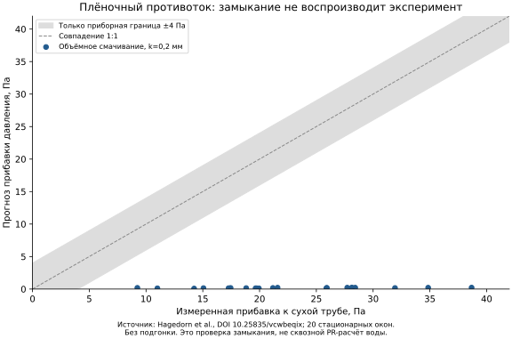

# Экспериментальная проверка многофазных замыканий

## Текущий вывод

**`darcy_volume_wetted_v1` не подтверждён для вертикального плёночного
противотока газ–жидкость.** На сопоставленных стационарных участках
измеренная прибавка перепада давления к сухой трубе составляет 9.23–38.68 Па,
а стационарный предел текущего замыкания даёт 0.039–0.236 Па в двух заранее
заданных вариантах шероховатости. Все 20 сопоставлений выходят за приборную
разностную границу ±4 Па. Это отрицательный результат проверки, а не
успешная калибровка.



Вывод относится к данному замыканию в данном режиме. Он не означает, что
другие газожидкостные или нефтеводяные режимы проверены или опровергнуты.
Совпадение однофазного Кольбрука и сохранение энергии в численных тестах
не подтверждают распределение смоченного периметра между фазами.

## Первичные данные и права использования

Использованы оригинальные, не изменённые по содержимому книги:

- `tests/data/surface/hannover_countercurrent/dry_pipe.xlsx`;
- `tests/data/surface/hannover_countercurrent/countercurrent.xlsx`.

Авторы: Janina Hagedorn, Markus Wirth, Bernhard Weigand, Stephan Kabelac.
Набор [Hydrodynamic investigations for a two-phase geothermal pipe](https://doi.org/10.25835/vcwbeqix)
распространяется по CC BY 4.0. Исходные имена членов архива, URL загрузки
и SHA-256 сохранены в `manifest.json`, лицензия — в `LICENSE.txt`.
Данные только переименованы для стабильных локальных путей.

Геометрия и условия сопоставлены с
[публикацией авторов](https://doi.org/10.1016/j.applthermaleng.2026.130975):
гладкая вертикальная труба диаметром 85 мм, расстояние между отборами
давления 3 м. Используются только гладкие трубы; гофрированные данные
не смешиваются с ними. Указанная авторами приборная граница DP — ±2 Па.

## Что именно сравнивается

Это **стационарная проверка замыкания сопротивления**, не сквозная
PR-симуляция воды и воздуха и не проверка переходного процесса.
Свойства воды заданы явно как референс при 20 °C: rho=998.2 kg/m³,
mu=0.001002 Pa·s. Плотность воздуха вычисляется из измеренных P/T в
идеально-газовом приближении; mu_air=1.81e-5 Pa·s. Эти свойства не названы
измеренными в книгах и не используются для заявления о точности PR воды.

При заданных расходах решается стационарный предел реально реализованного
`darcy_volume_wetted_v1`: общий градиент давления фаз, их собственные
скорости, смоченный периметр пропорционально объёмной доле. Межфазное
трение и химический BGK-источник в этом отдельном испытании отсутствуют.
Для восходящей координаты и нисходящей жидкости:

```
u_l = -m_l / (rho_l*A*alpha_l)
u_g = Q_g / (A*(1-alpha_l))
dp/dz |_l = -rho_l*g + f_l*rho_l*u_l^2/(2*D)
dp/dz |_g = -rho_g*g - f_g*rho_g*u_g^2/(2*D)
```

Выбирается тонкоплёночная газосодержащая ветвь `0 < alpha_l < 0.1`.
Используется тот же Torch `darcy_factor`, что в runtime. Отдельный
скалярный Кольбрук проверяет уравнение ветви в тесте. Шероховатости
0 и 0.2 мм заданы до сравнения; параметры по мокрому перепаду не обучаются.

Измеренные потери включают элементы стенда. Поэтому сравнивается **прибавка
мокрой трубы к измеренной сухой** при том же газовом объёмном расходе,
а не голое сопротивление трёхметровой трубы со всем стендом сразу.
Гидростатический член воздуха в пределе одинаковой плотности вычитается
вместе с сухой базой. Эффекты различий P/T, местных потерь, смачивания,
волн и нестационарности остаются ограничениями этого отдельного испытания.
Они не объявлены точно воспроизведёнными.

## Отбор данных до расчёта ошибки

Используются неперекрывающиеся блоки по 60 исходных записей. Это число
записей, **не** заявление о точно известной частоте дискретизации.
Условия принятия зависят только от входных измерений:

- конечные значения всех необходимых каналов;
- средний газовый расход 100–200 м³/ч, CV не выше 5%;
- для мокрого случая расход жидкости 0.03–0.13 kg/s, CV не выше 10%.

Ни давление, ни ошибка модели не используются для отбора стационарных окон.
Это отдельно проверяется тестом с изменением только измеренного давления.
Сухие окна объединяются в фиксированные интервалы по 5 м³/ч; между
средними расходами выполняется линейная интерполяция. Экстраполяции нет.

Получено 6 сухих и 31 мокрое окно; 20 мокрых покрываются сухой базой,
11 исключены из-за отсутствия покрытия. Все причины исключения и исходные
номера строк сохранены в машинном результате. Сглаживание или удаление
неудобных точек по итоговой ошибке не применяются.

Приборная разностная граница ±4 Па — сумма двух границ ±2 Па. Это **не**
95%-й доверительный интервал. Соседние временные измерения не считаются
независимыми для выдуманного уменьшения ошибки как 1/sqrt(N).

Средняя абсолютная ошибка прибавки: 22.26 Па для гладкого варианта и
22.17 Па при k=0.2 мм. Изменение шероховатости в этом диапазоне не устраняет
разрыв. Эти числа — диагностика данного испытания, не универсальная
метрика качества всех моделей течения.

## Что пока не засчитывается

- RELAP-7 bubbly/slug не переносится на опубликованный плёночный annular
  противоток за пределами своей области применимости.
- Горизонтальное stratified-замыкание не применяется к вертикальной трубе.
- KTH/HWAT DOI 10.5281/zenodo.14627088 найден и изучен, но не оценён:
  определения скорости и единицы отдельных полей требуют сверки с полной
  публикацией. Неоднозначные поля не пересчитываются молча.
- Пузырьковое удержание, нефть–вода, унос капель и тепловые свойства этим
  pressure-тестом не подтверждены.

## Воспроизведение

```bash
CUDA_VISIBLE_DEVICES='' OMP_NUM_THREADS=1 MKL_NUM_THREADS=1 PYTHONPATH=src:scripts \
  python scripts/validate_multiphase_experiments.py \
  --output /tmp/multiphase_experiments.json
```

Результат сохранён также в `benchmarks/results/multiphase_experiments.json`.
Этот исходный результат потребовал отдельной плёночной геометрии и
двустороннего переноса импульса, реализованных далее. Их собственная
экспериментальная проверка остаётся обязательной. Подгонка общего трения
для скрытия отсутствующего механизма не считается исправлением.

## Отдельная проверка кольцевой плёнки

Добавлен `src/surface/annular_film.py`: стационарная вертикальная
газожидкостная модель с полностью смоченным кольцевым слоем. Уравнение
Стокса интегрируется по реальной геометрии слоя с прилипанием к стенке
и касательным напряжением на границе газа. Удержание и общий градиент
давления решаются совместно; межфазные силы равны и противоположны.
Нет искусственного остаточного запаса, подгонки коэффициентов или
экстраполяции за найденную тонкоплёночную ветвь.

Межфазный Fanning-фактор .005*(1+300*delta/D) взят из Wallis, приведённого
в [первичной публикации](https://doi.org/10.1016/j.applthermaleng.2026.130975).
В этой реализации скорость — относительная скорость ядра и среднего
течения плёнки. Это явно отдельный вариант: в формулах цитируемой статьи
используется поверхностная скорость газа. Нельзя приписывать нашему
варианту экспериментальную подтверждённость исходной корреляции.

Уравнение профиля независимо проверено решением радиальной краевой задачи
SciPy в тестах; рабочий расчёт использует Torch и поддерживает CUDA.
Проверены балансы сил газа/жидкости, отказ вне области применимости,
CPU/CUDA и отсутствие корня при чрезмерном встречном газовом потоке.
Режим ограничен Gamma/mu <=400 и alpha_l <=0.3. Это не карта режимов,
не модель уноса капель и не переходная PR-труба.

Экспериментальная проверка **не пройдена**: из прежних 20 сопоставленных
окон 16 входят в объявленную область по расходу жидкости; четыре исключены
по этому входному критерию, без анализа ошибки давления. На этих же
16 окнах MAE исходной модели 21.74/21.67 Па, новой — 53.88/43.32 Па
для гладкой стенки/шероховатости 0.2 мм в сухом baseline. Все ошибки
выходят за инструментальный предел +/-4 Па. Увеличение межфазного трения
само по себе не исправило прогноз. Нужны независимые замыкания для
волновой/частично смоченной плёнки и уноса с подтверждением области
применимости; подбирать коэффициенты по этим же окнам нельзя.

Результат сохранён в `benchmarks/results/annular_film_experiments.json`,
повтор: `PYTHONPATH=src:scripts python scripts/validate_annular_film_experiment.py
--output /tmp/annular-film.json`. Исходный отрицательный результат не удалён.
Новый стационарный решатель **не включён** в динамическую PR-трубу:
замена её источника требует согласованного переноса энергии и новой
проверки переходных режимов. Экспериментальную квалификацию трёх блоков
по этим результатам закрытой считать нельзя.

## Динамический источник с работой на межфазной границе

Следующая реализация `laminar_annular_wallis_interface_v1` перенесена в
`pr_active_annular_friction.py` и подключается опционально к активной трубе.
От прежнего стационарного варианта она отличается использованием скорости
реальной поверхности плёнки, двусторонним импульсом, передачей работы
между полными энергиями фаз, ламинарным газовым пределом и решением
backward Euler. Подвижность тонкой плёнки вычисляется без потери значащих
цифр и без добавления фиктивной массы. Полные уравнения, ограничения и
параметры переходной области описаны в [PR_ACTIVE_SURFACE.md](PR_ACTIVE_SURFACE.md).

Независимые численные проверки:

- радиальная Stokes-краевая задача, без повторного вызова runtime-профиля;
- другое скалярное интегрирование профиля и NumPy 2x2 solve в аудиторе;
- DOP853-решение нелинейного локального ODE, с подтверждённым первым
  порядком по импульсу и межфазной энергии при уменьшении dt;
- laminar Poiseuille-предел газа при alpha_l→0, без остаточной фазы;
- конечный патрубок с командами открыто/закрыто/половина площади,
  гравитационные N/E-балансы, restart и CPU/CUDA-паритет.

Эти проверки подтверждают реализацию уравнений, а не экспериментальную
правильность корреляции Wallis в любом режиме. Повтор по тем же входным
окнам Hannover дал MAE 58.84/48.28 Па; ни одно из 16 окон не уложилось
в инструментальный разностный предел. Данные и коэффициенты не менялись.
Результат: `benchmarks/results/annular_interface_experiments.json`.
Для этого варианта CLI использует `--shear-velocity interface`.

Отрицательный вывод согласуется с ограничением самого источника данных:
в [заключении первичной статьи](https://www.sciencedirect.com/science/article/pii/S1359431126012834)
авторы сообщают, что рассмотренные корреляции не применимы к размерам и
скоростям их установки. Это не основание исключать неудобные точки и
объявлять наш вариант прошедшим. Для квалификации именно такого режима
нужны проверенные замыкания волн, смачивания и уноса либо независимые
данные по режиму, где выбранная модель применима. Четыре ранее исключённых
окна по-прежнему вне объявленной ламинарной области; они не возвращаются
в неё изменением порога после просмотра давления.

Общая функциональная матрица теперь содержит 11 CPU/CUDA-сценариев,
включая новый плёночный патрубок. Результаты с хешами источников:
`benchmarks/results/pr_active_annular_matrix.json`, сверка устройств —
`pr_active_annular_matrix_parity.json`. Их успешный статус не заменяет
отрицательный экспериментальный статус, хранящийся отдельно.


## Общий внешний барьер и актуальный повтор

`scripts/validate_surface_experiments.py` повторно использует существующие
проверяющие исходных Hannover-измерений и добавляет измеренные VLE-состояния
метан–этан May et al. Подробности термодинамического протокола приведены
в [REFERENCE_VALIDATION.md](REFERENCE_VALIDATION.md). Сравнения чистых
давлений по NIST Antoine сохраняются отдельно как эмпирические корреляции.
Численные тесты сохранения и результаты CoolProp в экспериментальные
прохождения не включаются.

```bash
PYTHONPATH=src:scripts python scripts/validate_surface_experiments.py \
  --output-dir /tmp/surface-external-validation
```

Каталог должен быть пустым. Сохраняются все отчёты, затем `summary.json`.
По умолчанию невыполнение заявленного Hannover-критерия возвращает код 1.
Это отрицательный результат квалификации режима, а не потерянный вывод
или авария численного решения. `--report-only` позволяет завершить
архивирование с кодом 0, сохраняя `gate_passed=false`; статус физической
валидации он не изменяет.

На текущем коде повторены все прежние варианты. Для используемого
межфазного варианта `laminar_annular_wallis_interface_v1` остаются MAE
58,84/48,28 Pa и нулевая доля попадания в инструментальный разностный
предел для всех 16 сопоставленных окон. Два заранее заданных варианта
сухой шероховатости не подбирались. Сухие/мокрые исходные книги, правила
отбора и область ламинарной модели не менялись. Физическая квалификация
этого режима не пройдена; положительное сравнение отдельных PR-свойств
этот результат не заменяет.

Барьер относится к конкретному стационарному противотоку и принятому
инструментальному сравнению. Его граница +/-4 Pa не является полным
бюджетом экспериментальной неопределённости или 95%-м интервалом.
Остаётся разбор источников расхождения, включая геометрию/смачивание,
волновую плёнку, унос и ограничения корреляции; вклад каждого механизма
нужно подтверждать данными, а не назначать по одному итоговому MAE.

Полная связанная переходная сеть, уровни/унос сепараторов, паспортные
карты оборудования и реальные нефтеводяные свойства требуют отдельных
экспериментальных наборов. Итог хранится в
`benchmarks/results/surface_external_validation.json`, полные отчёты —
в проверенном gzip-архиве рядом. Старые отрицательные отчёты сохранены.

## Область применимости и раздельные сухие серии

Проверка полной первичной статьи уточнила существенное ограничение:
в разделе 3 авторы прямо указывают невозможность гарантировать полное
смачивание стенки пилотной трубы и наблюдение отделившихся капель.
Раздел 2.1.2 описывает измерение перепада на участке с распределителем
жидкости. Это не измерение одного только установившегося кольцевого
течения. Доля смоченной стенки и отдельные мокрые потери распределителя
в используемых книгах не заданы.

Следовательно, отрицательный pressure-challenge не доказывает конкретную
ошибку реализации кольцевого профиля и не определяет поправочный
коэффициент. Даже совпадение давления само по себе не подтвердило бы
предположение о полном смачивании. В машинном отчёте разделены
`within_declared_pressure_bounds`, `annular_applicability` и
`qualification_blockers`; общий барьер требует устранения всех препятствий.
Существующие `FilmWettingCriterion` и `LongWaveWettingPotential`
переиспользуются в физическом коде. Эти модели не превращаются в
экспериментально подтверждённую долю смоченного периметра без входных
свойств материала и измерений.

Валидатор дополнен чувствительностью к выбору **каждой** сухой серии.
Прежний объединённый baseline, 16 окон модели, коэффициенты, приборная
граница и исходный отрицательный результат не меняются. Для каждой серии
отдельно применяются прежние фиксированные интервалы по 5 м³/ч и линейная
интерполяция без экстраполяции. Сравнение ошибок разных баз выполняется
только на одинаковых девяти мокрых окнах, покрытых обеими сухими сериями;
семь остальных не исчезают из исходной проверки.

На этих девяти окнах различие интерполированных сухих перепадов достигает
16.39 Pa. Для интерфейсной кольцевой модели MAE составляет:

- гладкая сухая труба: 48.59 Pa с серией `mess1`, 64.08 Pa с `mess2`;
- сухая шероховатость 0.2 mm: 38.27 и 53.76 Pa соответственно.

Ни один из девяти прогнозов ни в одном варианте не попадает в прежнюю
инструментальную разностную границу. Разброс сухих серий сам по себе
расхождение не устраняет. Этот анализ **не** задаёт доверительный интервал
и не увеличивает допустимую ошибку. Выбор более удобной серии запрещён
протоколом. Результаты повторного общего прогона с хешами исходников:
`benchmarks/results/surface_external_series_audit.json` и
`surface_external_series_audit_reports.json.gz`. Исходные результаты
предыдущей версии сохранены отдельно.

## Независимые измерения плёнки FETRig

[Набор ITLR FETRig](https://doi.org/10.18419/DARUS-4998), CC BY 4.0,
содержит измерения CCI толщины водяной плёнки и соответствующие
LabView-записи условий. Геометрия — прямоугольный канал шириной 100 mm
и глубиной 30 mm с медной стенкой, а не Hannover-труба диаметром 85 mm.
Эти геометрии не подменяются друг другом.

`scripts/import_fetrig_measurements.py` импортирует заранее фиксированный
набор: станции из имён `Y_100` и `Y_600`, `X_50`, метки `ReL500`,
`ReG0/12900/20900`. Каждому файлу CCI соответствует исходная книга LabView.
Метки имён — уставки, их нельзя считать фактическими измеренными числами
Рейнольдса без обработки каналов. Оригинальные MATLAB-описания обработки
сохраняются как данные и не исполняются.

Импорт использует HTTP byte ranges и стандартный ZIP64-reader; архив
5.4 GB целиком не скачивается. Сервер, игнорирующий или смещающий Range,
отклоняется до чтения тела. На каждое извлечённое содержимое проверяется
ZIP CRC и сохраняется SHA-256; опубликованный MD5 всего архива отмечен
как значение провайдера, а не самостоятельно вычисленный MD5 полного
файла. Gzip-сжатие не меняет исходное содержимое. Названия, происхождение,
лицензия и ограничения перечислены в локальном `manifest.json`.

```bash
python scripts/import_fetrig_measurements.py \
  --output /tmp/fetrig-independent-measurements
```

Это подготовка независимого эксперимента, **не** его успешное прохождение.
Перед физическим сравнением нужны проверка единиц, критериев `GO/ALARM`,
нулевого отсчёта датчика, временного согласования и фактических расходов.
Измерения толщины и волн позволят отдельно проверять гравитационный
профиль и влияние газа; подгонка по Hannover-перепадам для этого не нужна.

Локальная выгрузка содержит 17 исходных файлов; передано 5,641,566 байт
архива вместо 5.4 GB. `scripts/audit_fetrig_measurements.py` проверяет
хеши всех файлов и обрабатывает шесть CCI-записей по 100,000 отсчётов.
Единицы берутся из `OUT01(mm)`, а не из поля разрешения дисплея.
Шаг подтверждён заголовками файлов: 200 us. Пропусков trigger count
в этих шести записях нет; флаги `ALARM` сохранены в счётчиках, а не
заменены нулевой толщиной. Статистики mean/std рассчитываются только
по `GO`, как в исходном `Keyence_Data_Manager.m`, без замены выбросов.
От 0 до 5.097% отсчётов отдельных записей имеют `ALARM`; возможное
неравномерное выпадение датчика не названо случайной погрешностью.
Это описательная статистика датчика без заявления о проверенном нуле
или физической квалификации модели. Результат:
`benchmarks/results/fetrig_input_audit.json`.
