# Norne: полная история против Eclipse

Norne — открытая модель месторождения Equinor в Норвежском море (набор [OPM opm-tests](https://github.com/OPM/opm-tests),
deck `norne/NORNE_ATW2013.DATA`). Это стандартный тест для гидродинамических симуляторов: corner-point сетка
с разломами, жирный газ, несколько регионов, 36 скважин с реальным расписанием. Мы считаем deck без изменений и
сравниваем с расчётом Eclipse 2014.2, который лежит в том же наборе (`norne/ECL.2014.2`), и с OPM Flow.

## Постановка

| | |
|---|---|
| Сетка | 46 × 112 × 22 = 113 344 ячейки, 44 431 активная, 61 разлом, 13 455 несоседских связей |
| Период | 6 ноября 1997 — 1 декабря 2006, 3312 суток |
| Скважины | 36: добывающие и нагнетательные (вода, газ, WAG), WCONHIST/WCONINJH, WELOPEN, COMPDAT, WTEST |
| Флюиды | PVTO/PVTG с растворённым газом и испарённой нефтью, VAPPARS, несколько регионов PVT и ОФП |
| ОФП | Таблицы SWOF/SGOF, масштабирование концевых точек, гистерезис Карлсона |
| Оборудование | AMD Ryzen 9 9900X, NVIDIA RTX 3090 Ti, PyTorch 2.7, float64 |

Сравниваются векторы SUMMARY в отчётные даты deck. Исторические замеры (WOPRH и т.п.) — то, за чем следует
управление скважин; цель — совпасть не с историей, а с Eclipse на том же deck.

## Итог по месторождению

| вектор | Eclipse 2014.2 | наш | разница | OPM Flow |
|---|---|---|---|---|
| FOPT, млн м³ | 67.32 | 67.32 | 0.00% | −0.21% |
| FWPT, млн м³ | 23.20 | 23.32 | +0.50% | +1.40% |
| FGPT, млрд м³ | 14.64 | 14.63 | −0.05% | −0.44% |
| FWIT, млн м³ | 102.1 | 101.95 | −0.14% | +0.39% |
| FGIT, млрд м³ | 8.685 | 8.685 | 0.00% | — |

Накопленная нефть по годам: +0.04%, +0.07%, +0.50%, +0.18%, +0.18%, +0.14%, +0.02%, −0.01%, 0.00%.
Среднее по времени расхождение дебитов: нефть 0.65%, вода 1.08%, газ 0.70%, закачка воды 0.06%.
Среднее давление по объёму углеводородов к концу — 270.8 бар против FPR Eclipse 271.6 бар. Свободный газ в пласте
совпадает с балансом FREE GAS в PRT Eclipse до 0.01–0.08 млрд м³.

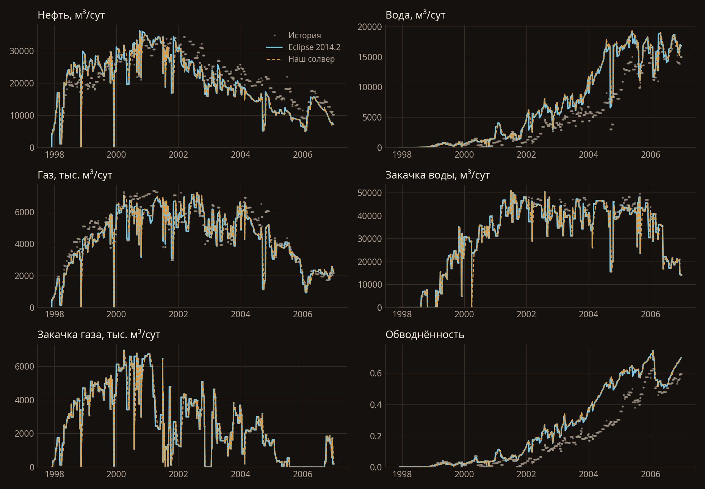

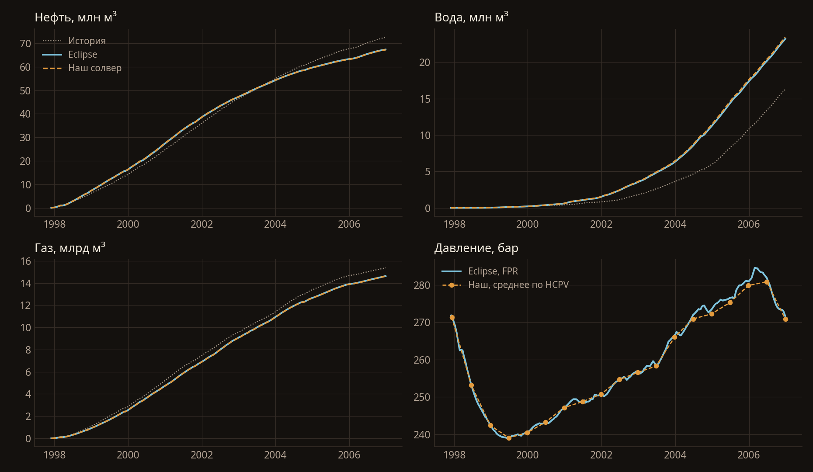

## Скважины

Накопленная нефть двенадцати крупнейших добывающих скважин:

| скважина | наш, млн м³ | Eclipse | разница |
|---|---|---|---|
| B-2H | 10.83 | 10.82 | +0.1% |
| E-1H | 8.03 | 8.04 | −0.2% |
| E-2H | 7.81 | 7.82 | −0.1% |
| D-2H | 7.66 | 7.53 | +1.7% |
| B-3H | 6.12 | 6.11 | +0.1% |
| D-1H | 5.45 | 5.50 | −1.0% |
| D-3AH | 3.61 | 3.66 | −1.1% |
| B-1H | 3.59 | 3.58 | +0.0% |
| D-4H | 3.18 | 3.17 | +0.2% |
| E-3H | 1.69 | 1.69 | +0.0% |
| B-1BH | 1.42 | 1.42 | −0.4% |
| D-1CH | 1.29 | 1.32 | −1.9% |

Наибольшие расхождения по скважинам: накопленная вода E-4AH +17% (+30 тыс. м³), B-1H −15% (−71 тыс. м³), D-4AH −11% (−1 тыс. м³); нефть по этим скважинам в пределах 2%.
Участки забоя на 1 атм — нижний предел из deck; Eclipse садится на него в те же периоды (D-1H — 117 суток у обоих).

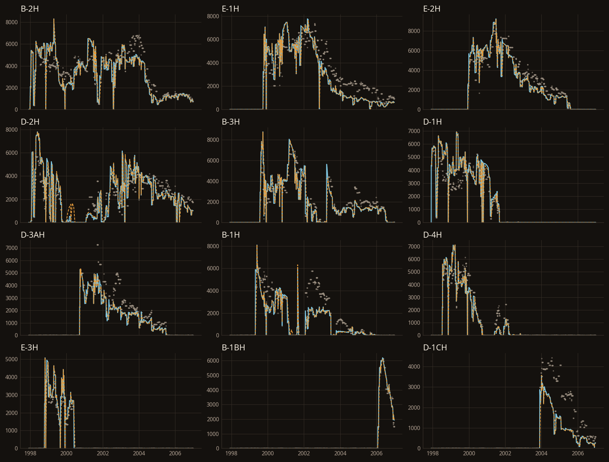

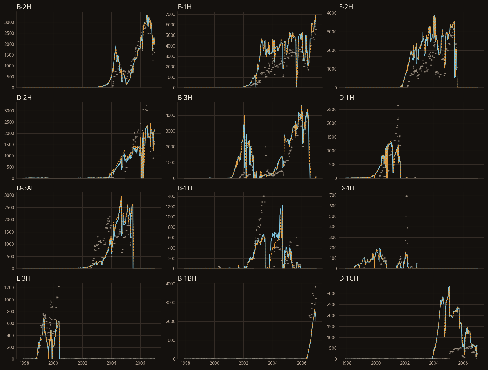

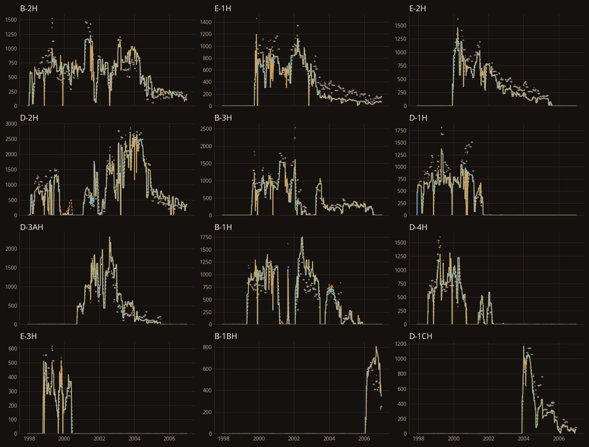

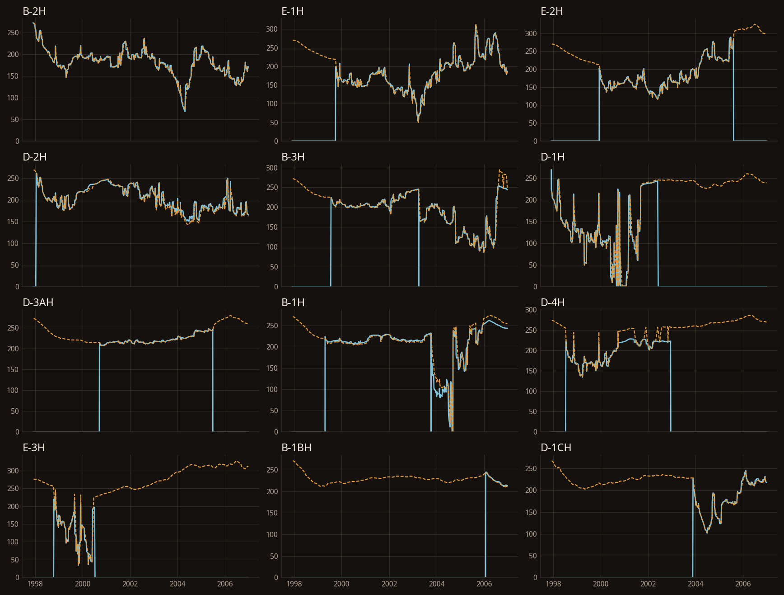

## Поля

Нефтенасыщенность, вода, газ и давление — среднее по разрезу с весом порового объёма; объёмный вид — столбы
corner-point из EGRID, вертикаль растянута в 5 раз.


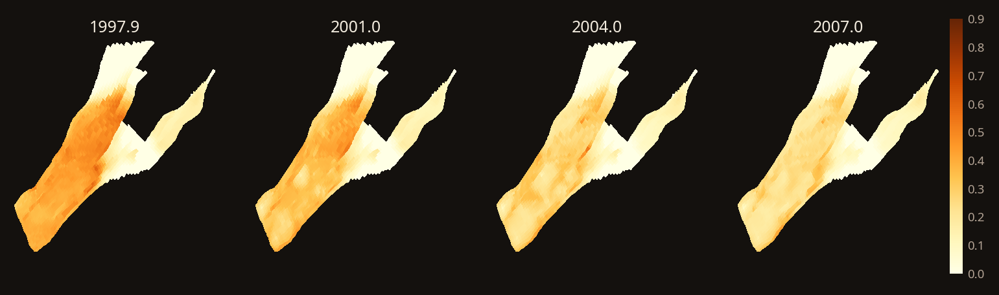

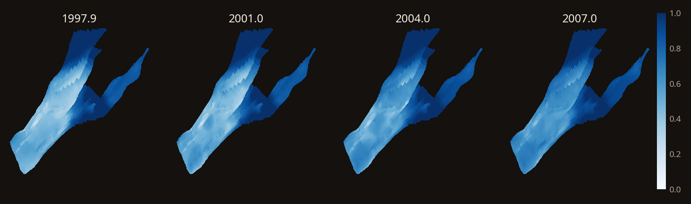

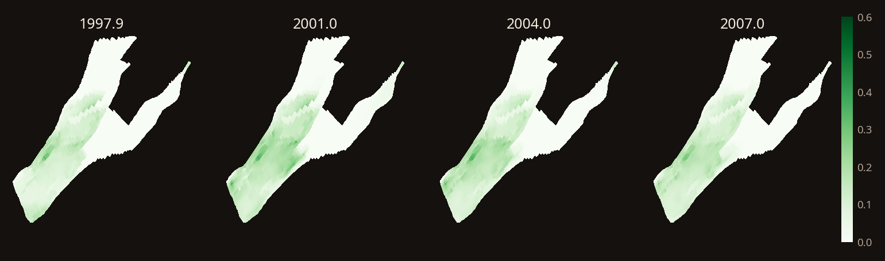

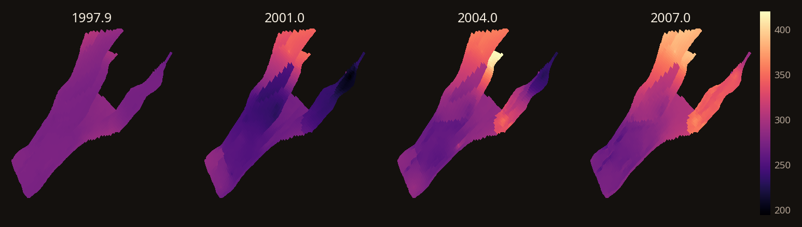

## Решатель

779 с на всю историю: 709 шагов по времени, 3309 итераций Ньютона (4.7 на шаг), 8 шагов разрезаны, минимального
шага нет. В системе только 44 431 активная ячейка. Линейная система — FGMRES с CPR (AMG по давлению, блочный Якоби), всё на GPU; изолированные ячейки
решаются отдельно, иерархия AMG строится один раз и затем только обновляется.

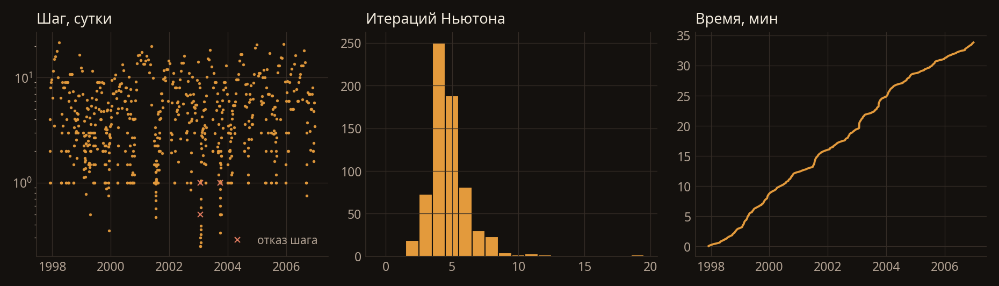

## Особенности deck, которые важны для совпадения

- **VAPPARS после DRSDT.** Из двух ключевых слов действует последнее; в Norne VAPPARS отключает заданный раньше
  DRSDT (так же поступает Eclipse).
- **RESV.** Исторический пластовый дебит пересчитывается в поверхностный при среднем давлении, Rs — среднее по
  объёму нефти, Rv — по объёму газа (как RateConverter в OPM).
- **PVTG выше таблицы.** Таблица кончается на 594 бар, а у нагнетательной C-1H давление доходит до ~760 бар;
  1/Bg и 1/(Bg·μg) экстраполируются, но не опускаются ниже половины значений на краю таблицы.
- **Смешение в стволе нагнетательной скважины.** Переток из пласта в ствол смешивается и уходит обратно через
  закачивающие перфорации.

## Как воспроизвести

```bash
git clone --filter=blob:none https://github.com/OPM/opm-tests.git
NORNE_DIR=opm-tests/norne NORNE_OUT=results/norne python scripts/run_norne.py
NORNE_DIR=opm-tests/norne NORNE_OUT=results/norne python scripts/norne_figures.py
```

`run_norne.py` пишет `summary.npz` (все векторы SUMMARY), `fields.npz` (давление и насыщенности раз в полгода),
`substeps.npz` (шаги и итерации Ньютона) и `meta.json`. Необязательный аргумент — число суток. Переменные:
`NORNE_DEVICE` (по умолчанию `cuda`), `NORNE_CKPT` и `NORNE_CKPT_EVERY` — чекпоинт каждые n отчётных шагов,
`NORNE_RESUME` — продолжить с чекпоинта (~106 МБ). `norne_figures.py` строит рисунки этой страницы и печатает
сводные цифры в JSON.

Регрессия: `NORNE_DIR=opm-tests/norne pytest tests/test_norne_regression.py` — концевые точки против INIT Eclipse и
первый год истории против Eclipse.

## Чего в расчёте нет

VFP-таблицы и ограничения по устьевому давлению (в WCONHIST Norne VFP не задана), трассеры, WECON,
поверхностная сеть.
