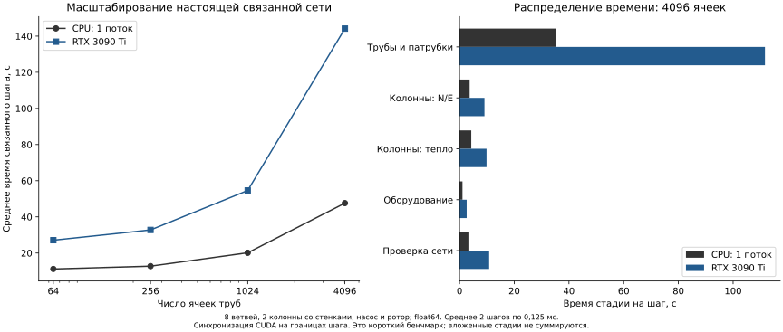

# Бенчмарк связанной активной PR-сети

## Результат и его пределы

Контрольная версия после пакетирования EOS: на 4096 ячейках
**12.33 с/шаг на CPU (один поток)** и **26.73 с/шаг на RTX 3090 Ti**.
Относительно исходного исполнения это ускорение в 3.86 и 5.39 раза.
На данной связанной задаче GPU всё ещё медленнее CPU примерно в 2.17 раза.
Это два коротких шага, а не время длительной промысловой симуляции.

Исходный профиль до пакетирования:


Это реальная связанная модель: 8 ветвей труб, 2 гравитационные колонны,
конечные тепловые стенки, 2 сосуда оборудования, насос и динамический ротор.
Есть параллельные пути и замкнутый путь через насос. Потоки вычисляются
решателем, а не задаются искусственно. В трубах 2 PR-фазы смеси C1/C6;
параметр воды есть в общей EOS-карте, но её запас равен нулю. Это не
валидация PVT воды, нефтяного ассая или промысловой инфраструктуры.

**Каждый масштаб измерялся на двух шагах по 0.125 мс: всего 0.25 мс
модельного времени.** Это бенчмарк размера/стоимости шага, не длительный
суточный расчёт и не подтверждение промышленной производительности.
CFL явной трубы ограничивает шаг; измеренное время нельзя выдавать за
стоимость прохождения большого физического интервала.

## Измеренные масштабы

Количество ячеек: 64, 256, 1024, 4096. Число ветвей и оборудования
сохраняется, меняется число физических ячеек на ветвь. Длина ячейки 10 м,
диаметр трубы 50 мм; волновая граница 4000 м/с. Используются рельеф,
адиабатическое трение, конечные патрубки, тепловое восстановление колонн
и неявное оборудование. Ни один из этих блоков не выключен ради времени.

CPU: AMD Ryzen 9 9900X, OMP_NUM_THREADS=1, MKL_NUM_THREADS=1.
GPU: RTX 3090 Ti, UUID GPU-2f9ce359-f3f4-accc-bf9c-31bc88bb1cb7.
На RTX 3090 параллельно шёл другой расчёт; на измеряемой 3090 Ti
зафиксирован только процесс бенчмарка. Весь хост не объявляется полностью
эксклюзивным. Измерения используют float64. Два повторения не дают
оснований заявлять статистически устойчивые p95 или доверительный интервал.

Инициализация измерена отдельно. Для GPU выполняется synchronize на
границах полного шага. Профили функций — inclusive host wall time:
родительские и вложенные функции нельзя складывать как независимые стадии.
Накладные расходы профилирования не вычитаются. Столбцы на рисунке показывают
верхние стадии; вложенные EOS-вызовы опубликованы отдельно в JSON.

## Выявленные ограничения

### Повтор после пакетирования EOS

В `pr_batched_homogeneous.py` скалярное differentiable PR-ядро выполняется
через `torch.vmap` отдельно по типам корней. Входы включают только реально
присутствующие фазы. `inspect` и заключительная проверка UV больше не
вызывают EOS и передачу результатов на CPU отдельно для каждой фазы.
Проверки устойчивости корня, энергии, объёма и исходные допуски сохранены.

При тех же 4096 ячейках и двух шагах среднее время CPU изменилось
с 47.6158 до 12.3073 с (3.87 раза), RTX 3090 Ti — с 144.1701 до
26.4181 с (5.46 раза). Это стоимость шага данного короткого бенчмарка,
не время полного Norne. На этом размере CPU всё ещё быстрее GPU в 2.15 раза.
На 64 ячейках после изменения: CPU 10.9762 с, GPU 25.4529 с.

Сравнение старых источников с сохранённым архивом и новых источников с
текущими файлами выполнено перед сравнением checkpoint. Все числовые
поля конечного физического состояния на 4096 ячейках до/после совпали
точно в JSON на каждом устройстве. Между CPU/CUDA прошла прежняя проверка
с atol=rtol=1e-8. Независимый скалярный EOS-аудитор повторно проверил 8192
фазы и профили колонн на каждом устройстве. Это проверка конечного состояния;
полный пространственный аудит траектории по-прежнему выполнен на 64 ячейках.

Результаты: `benchmarks/results/pr_active_surface_batched_scaling.json`,
`pr_active_surface_batching_comparison.json` и
`pr_active_surface_batched_checkpoint_audits.json`. Исходный результат сохранён.
Повторяемое сравнение: `scripts/compare_pr_active_optimization.py` требует
старый архив источников, пары старых/новых отчётов и явный список размеров.

После ускорения на GPU восстановление запасов колонн занимает 8.92 с/шаг,
тепловой solve — 9.60 с/шаг; на CPU — 3.63 и 4.27 с соответственно.
Они стали основными следующими кандидатами для оптимизации. Профили
inclusive; вложенные времена не суммируются. Ускорение интегратора,
длительные переходные расчёты и сохранение всего состояния на GPU остаются
отдельной работой.

### Зафиксированный контроль после EOS-пакетирования

После подключения опционального динамического плёночного источника повторены
оба размера 64/4096 и оба устройства с теми же настройками. Для 4096:
CPU-шаги 12.7004 и 11.9557 с; CUDA-шаги 26.7015 и 26.7640 с.
Новые средние 12.3281 и 26.7328 с согласуются с предыдущим коротким замером;
по двум повторениям статистическая значимость небольших различий не заявляется.
CPU и GPU запускались последовательно после завершения функциональной
матрицы и тестов. Во время CUDA-прогона CPU выполнял независимый аудит
законченного CPU checkpoint; весь хост эксклюзивным не объявляется.

Текущий бенчмарк сохраняет **прежнее объёмно-смоченное Darcy-замыкание**:
плёночная вертикальная модель не применяется к его почти горизонтальным
сегментам. Поэтому это проверка регрессий общей сети и масштабирования
пакетной EOS, не крупная валидация динамического кольцевого течения.
На 64 ячейках повторён полный пространственный аудит, на 4096 — конечные
8192 фазовых EOS-состояния и более точные профили колонн на устройство.
Все числовые поля конечного состояния на каждом устройстве совпали с
исходным исполнением точно; новые источники и старый архив проверены по SHA.

Актуальные сводки: `benchmarks/results/pr_active_surface_final_scaling.json`,
`pr_active_surface_final_comparison.json`, `pr_active_surface_final_checkpoint_audits.json`.
Исторические сводки сохранены отдельно и не выдаются за запуски нынешнего
дерева источников. Полные многомегабайтные checkpoints остаются результатами
запуска; компактные JSON из документации включены точечными исключениями
в `.gitignore`, чтобы не потерять их при обычном `git add .`.

Эти SHA относятся к версии до добавления команд пофазной тепловой мощности
активной трубы. После их реализации выполнены отдельные функциональные
CPU/CUDA-прогоны и общая регрессия; приведённые времена не переименовываются
в измерения нового теплового режима. Производительность заданного нагрева
нужно измерять на своей конфигурации и физическом интервале.

### Исходный профиль до пакетирования

На 4096 ячейках GPU тратит около 111.65 с на трубы и патрубки, из них
75.45 с — вложенные проверки EOS. Трение занимает 43.23 с inclusive и
пересекается с этими проверками: это не дополнительное независимое время.
Восстановление запасов колонн занимает 9.12 с, тепловой solve — 9.88 с,
оборудование — 2.62 с, общая проверка сети — 10.84 с.

Основное масштабируемое ограничение — поячеечные EOS-вызовы и
синхронизации с Python/CPU. При малых сетках заметны также повторное
восстановление гравитационного профиля и отдельный тепловой solve.
Следующие оптимизации должны пакетировать EOS, сохранять состояния на
устройстве и использовать предыдущую ветвь/решение колонн; отдельно нужен
анализ интегратора для длительных интервалов. Уменьшение точности или
пропуск проверок не засчитывается как ускорение.

Это измерение только новой активной наземной ветви. Оно не относится к
скорости пластового Norne, FIM или прежнего неявного равновесного графа.

## Проверки результатов

В каждом запуске сам бенчмарк отдельно суммирует физические запасы
компонентов и полную энергию, включая потенциальную энергию, стенки и ротор.
Сравнение выполняется с учётом внешнего тепла/работы и округлительной
границы. Максимальная измеренная невязка энергии по запускам меньше
9e-7 Дж. Допуски исходного решателя не изменялись.

`check_pr_active_surface_benchmark.py` независимо проверяет скалярную PR
для каждой присутствующей фазы конечного checkpoint и 32-точечный профиль
колонн; для 4096 ячеек это 8192 фазовых EOS-проверки на устройство.
Большая временная траектория этим аудитором **не** восстанавливается.
Полный скалярный пространственный аудит шагов выполнен на 64 ячейках.

Конечные состояния всех четырёх размеров прошли CPU/CUDA-сверку
с atol=1e-8 и rtol=1e-8. Само совпадение устройств не является
экспериментальной проверкой физики.

## Воспроизведение

```bash
CUDA_VISIBLE_DEVICES='' OMP_NUM_THREADS=1 MKL_NUM_THREADS=1 PYTHONPATH=src:scripts \
  python scripts/benchmark_pr_active_surface.py \
  --cells 64 256 1024 4096 --branches 8 --steps 2 \
  --device cpu --output /tmp/scaling_cpu.json

CUDA_VISIBLE_DEVICES=GPU-2f9ce359-f3f4-accc-bf9c-31bc88bb1cb7 \
OMP_NUM_THREADS=1 MKL_NUM_THREADS=1 PYTHONPATH=src:scripts \
  python scripts/benchmark_pr_active_surface.py \
  --cells 64 256 1024 4096 --branches 8 --steps 2 \
  --device cuda --output /tmp/scaling_cuda.json

CUDA_VISIBLE_DEVICES='' OMP_NUM_THREADS=1 MKL_NUM_THREADS=1 PYTHONPATH=src:scripts \
  python scripts/check_pr_active_surface_benchmark.py /tmp/scaling_cpu.json

PYTHONPATH=src:scripts python scripts/summarize_pr_active_benchmark.py \
  --cpu /tmp/scaling_cpu.json --cuda /tmp/scaling_cuda.json \
  --output /tmp/scaling_summary.json
```

Компактные измерения и хеши физических исходников сохранены в
`benchmarks/results/pr_active_surface_scaling.json`; большие конечные
checkpoint в Git не добавлены. Исходные полные JSON для этой сессии:
`/tmp/pr-active-scale-probe.json`, `/tmp/pr-active-scale-cpu.json`,
`/tmp/pr-active-scale-cuda.json`. Они нужны для полной повторной проверки
сохранённых состояний; компактный файл их не заменяет.
